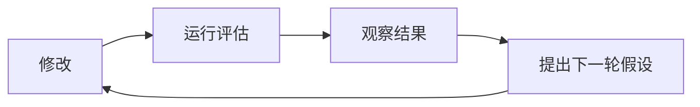

# 实验 { #experiments }

## 什么是实验？ { #what-is-an-experiment }

实验是为了验证假设或想法而有目的地修改应用。例如，在检索增强生成（RAG）系统中，你可以更换检索模型，评估新的嵌入模型会如何影响聊天机器人的回答。

### 良好实验的原则 { #principles-of-a-good-experiment }

1. **定义可量化的指标**。通过准确率、精确率或召回率等指标衡量改动的效果。
2. **有序存储结果**。以统一方式组织结果，便于比较和跟踪。
3. **控制变量**。每次只修改一个因素，以确定其具体影响。同时修改多个因素会使结果难以解释。
4. **持续迭代**。按照“修改 → 评估 → 观察结果 → 提出下一轮假设”的流程推进。



## Ragas 中的实验 { #experiments-in-ragas }

### 实验的组成 { #components-of-an-experiment }

1. **测试数据集**，用于评估系统的数据
2. **应用端点**，被测试的应用、组件或模型
3. **指标**，用于衡量表现的定量度量

### 执行流程 { #execution-process }

1. **准备**，定义实验参数，加载测试数据集
2. **运行**，对数据集中的每个样本执行应用
3. **评估**，使用指标衡量表现
4. **存储**，保存结果以供分析和比较

## 使用 Ragas 创建实验 { #creating-experiments-with-ragas }

Ragas 提供 `@experiment` 装饰器，简化实验创建流程。如果想先动手体验，请阅读[快速开始指南](../getstarted/quickstart.md)。

### 基本实验结构 { #basic-experiment-structure }

```python
from ragas import experiment
import asyncio

@experiment()
async def my_experiment(row):
    # Process the input through your system
    response = await asyncio.to_thread(my_system_function, row["input"])

    # Return results for evaluation
    return {
        **row,  # Include original data
        "response": response,
        "experiment_name": "baseline_v1",
        # Add any additional metadata
        "model_version": "gpt-4o",
        "timestamp": datetime.now().isoformat()
    }
```

### 运行实验 { #running-experiments }

```python
from ragas import Dataset

# Load your test dataset
dataset = Dataset.load(name="test_data", backend="local/csv", root_dir="./data")

# Run the experiment
results = await my_experiment.arun(dataset)
```

### 参数化实验 { #parameterized-experiments }

可以通过参数化实验测试不同配置。

```python
@experiment()
async def model_comparison_experiment(row, model_name: str, temperature: float):
    # Configure your system with the parameters
    response = await my_system_function(
        row["input"],
        model=model_name,
        temperature=temperature
    )

    return {
        **row,
        "response": response,
        "experiment_name": f"{model_name}_temp_{temperature}",
        "model_name": model_name,
        "temperature": temperature
    }

# Run with different parameters
results_gpt4 = await model_comparison_experiment.arun(
    dataset,
    model_name="gpt-4o",
    temperature=0.1
)

results_gpt35 = await model_comparison_experiment.arun(
    dataset,
    model_name="gpt-3.5-turbo",
    temperature=0.1
)
```

## 实验管理最佳实践 { #experiment-management-best-practices }

### 1. 一致的命名 { #1-consistent-naming }

使用描述性的名称，包含以下信息。
- 改动内容，例如模型、提示词或参数
- 版本号
- 日期与时间（如有必要）

```python
experiment_name = "gpt4o_v2_prompt_temperature_0.1_20241201"
```

### 2. 结果存储 { #2-result-storage }

实验会自动将结果保存到 `experiments/` 目录中的 CSV 文件，并记录时间戳。

```
experiments/
├── 20241201-143022-baseline_v1.csv
├── 20241201-143515-gpt4o_improved_prompt.csv
└── 20241201-144001-comparison.csv
```

### 3. 元数据跟踪 { #3-metadata-tracking }

在实验结果中记录相关元数据。

```python
return {
    **row,
    "response": response,
    "experiment_name": "baseline_v1",
    "git_commit": "a1b2c3d",
    "environment": "staging",
    "model_version": "gpt-4o-2024-08-06",
    "total_tokens": response.usage.total_tokens,
    "response_time_ms": response_time
}
```

## 进阶实验模式 { #advanced-experiment-patterns }

### A/B 测试 { #ab-testing }

同时测试两种不同方案。

```python
@experiment()
async def ab_test_experiment(row, variant: str):
    if variant == "A":
        response = await system_variant_a(row["input"])
    else:
        response = await system_variant_b(row["input"])

    return {
        **row,
        "response": response,
        "variant": variant,
        "experiment_name": f"ab_test_variant_{variant}"
    }

# Run both variants
results_a = await ab_test_experiment.arun(dataset, variant="A")
results_b = await ab_test_experiment.arun(dataset, variant="B")
```

### 多阶段实验 { #multi-stage-experiments }

对于包含多个组件的复杂系统，可以采用以下方式。

```python
@experiment()
async def multi_stage_experiment(row):
    # Stage 1: Retrieval
    retrieved_docs = await retriever(row["query"])

    # Stage 2: Generation
    response = await generator(row["query"], retrieved_docs)

    return {
        **row,
        "retrieved_docs": retrieved_docs,
        "response": response,
        "num_docs_retrieved": len(retrieved_docs),
        "experiment_name": "multi_stage_v1"
    }
```

### 实验中的错误处理 { #error-handling-in-experiments }

妥善处理错误，避免丢失已经得到的部分结果。

```python
@experiment()
async def robust_experiment(row):
    try:
        response = await my_system_function(row["input"])
        error = None
    except Exception as e:
        response = None
        error = str(e)

    return {
        **row,
        "response": response,
        "error": error,
        "success": error is None,
        "experiment_name": "robust_v1"
    }
```

## 集成评估指标 { #integrating-with-metrics }

实验可以直接使用 Ragas 指标。

```python
from ragas.metrics import FactualCorrectness

@experiment()
async def evaluated_experiment(row):
    response = await my_system_function(row["input"])

    # Calculate metrics inline
    factual_score = FactualCorrectness().score(
        response=response,
        reference=row["expected_output"]
    )

    return {
        **row,
        "response": response,
        "factual_correctness": factual_score.value,
        "factual_reason": factual_score.reason,
        "experiment_name": "evaluated_v1"
    }
```

这样可以自动计算指标得分并将其与实验结果一同保存，便于跟踪系统表现随时间的变化。
