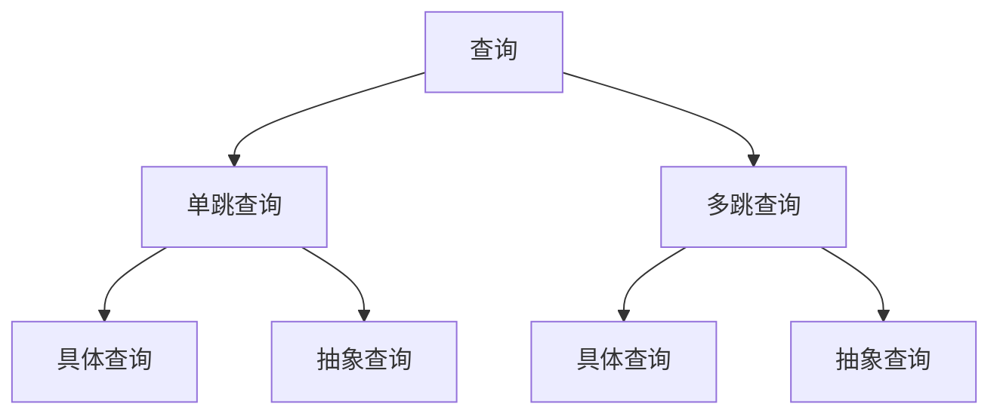
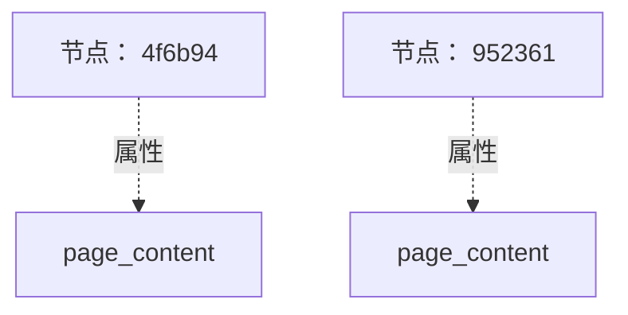
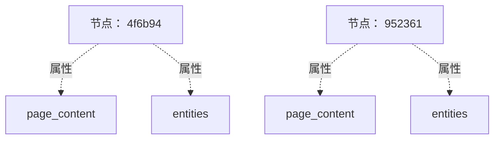
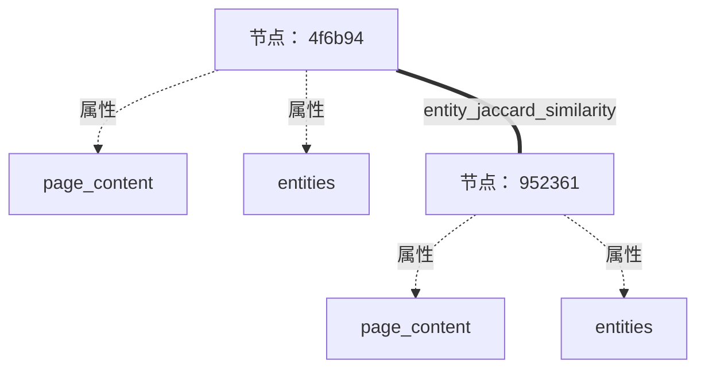

# 为 RAG 生成测试集 { #testset-generation-for-rag }

用户在 RAG 应用中与一组文档交互时，会提出不同形式的查询。先来了解 RAG 应用中常见的查询类型。

## RAG 中的查询类型 { #query-types-in-rag }



### 单跳查询 { #single-hop-query }

单跳查询只需从一个文档或来源检索信息，即可给出相关答案，只涉及一步信息获取。

**示例，具体查询**

- “阿尔伯特·爱因斯坦在哪一年发表了相对论？”

这是一个基于事实的具体问题，只需从包含相关信息的文档中检索一次即可回答。

**示例，抽象查询**

- “爱因斯坦的理论如何改变了我们对时间与空间的理解？”

虽然仍然围绕相对论这一个概念，但需要根据原始资料给出更抽象、带有解释性的回答。

### 多跳查询 { #multi-hop-query }

多跳查询涉及多步推理，需要从两个或更多来源获取信息。系统必须检索多个文档，并将信息关联起来，才能生成准确答案。

**示例，具体查询**

- “哪位科学家影响了爱因斯坦的相对论研究，这位科学家提出了什么理论？”

系统需要分别检索影响爱因斯坦的科学家及其理论，这些信息可能来自不同资料。

**示例，抽象查询**

- “自爱因斯坦最初发表相对论以来，相关科学理论经历了怎样的发展？”

这一抽象查询需要跨时间、跨来源检索多项信息，综合解释理论的演变。

### RAG 中的具体查询与抽象查询 { #specific-vs-abstract-queries-in-a-rag }

- **具体查询**关注明确、基于事实的信息。检索目标是从一个或多个文档中找到能直接回答具体问题的高度相关信息。

- **抽象查询**需要更宽泛、解释性更强的回答。检索系统需要找到包含高层推理、解释或观点的文档。

对于单跳和多跳查询，具体与抽象的区别都会影响检索及生成过程，决定系统应重点关注精确事实，还是综合更广泛的观点。

不同查询类型需要合成不同的上下文。Ragas 通过基于知识图谱的方法生成测试集。

## 构建知识图谱 { #knowledge-graph-creation }

要从给定文档中生成不同类型的查询，主要挑战是找到合适的片段或文档组合，让 LLM 据此提出问题。Ragas 使用知识图谱解决这一问题。

<figure markdown="span">
  {width="auto"}
  <figcaption>构建知识图谱</figcaption>
</figure>


知识图谱通过以下组件构建。

### 文档切分器 { #document-splitter }

文档切分后形成具有层级关系的节点，可以根据内容选择不同切分器。例如，财务文档可以按利润表、资产负债表和现金流量表等章节切分。你也可以编写[自定义切分器]()，按领域中有意义的章节组织文档。

#### 示例 { #example }

```python
from ragas.testset.graph import Node

sample_nodes = [Node(
    properties={"page_content": "Einstein's theory of relativity revolutionized our understanding of space and time. It introduced the concept that time is not absolute but can change depending on the observer's frame of reference."}
),Node(
    properties={"page_content": "Time dilation occurs when an object moves close to the speed of light, causing time to pass slower relative to a stationary observer. This phenomenon is a key prediction of Einstein's special theory of relativity."}
)]
sample_nodes
```
输出如下。
```bash
[Node(id: 4f6b94, type: , properties: ['page_content']),
 Node(id: 952361, type: , properties: ['page_content'])]
```



### 提取器 { #extractors }

提取器从各个节点中获取信息，用于建立节点间的关系。例如，财务文档可以通过实体提取器获取公司名称，通过关键短语提取器获取重要短语。你也可以编写自定义提取器，获取领域所需的信息。

提取器可以基于 LLM，继承 `LLMBasedExtractor`，也可以基于规则，继承 `Extractor`。

#### 示例 { #example_1 }

假设知识图谱中有一个示例节点，可以使用 `NERExtractor` 提取其中的命名实体。

```python
from ragas.testset.transforms.extractors import NERExtractor

extractor = NERExtractor()
output = [await extractor.extract(node) for node in sample_nodes]
output[0]
```
返回值是一个元组，包含提取器类型和提取出的信息。

```bash
('entities', ['Einstein', 'theory of relativity', 'space', 'time', "observer's frame of reference"])
```

将提取出的信息加入节点。

```python
_ = [node.properties.update({key:val}) for (key,val), node in zip(output, sample_nodes)]
sample_nodes[0].properties
```

输出如下。
```bash
{'page_content': "Einstein's theory of relativity revolutionized our understanding of space and time. It introduced the concept that time is not absolute but can change depending on the observer's frame of reference.",
'entities': ['Einstein', 'theory of relativity', 'space', 'time', 'observer']}
```




### 关系构建器 { #relationship-builder }

提取出的信息用于建立节点间的关系。例如，财务文档可以根据节点中共有的实体建立联系。
你可以编写[自定义关系构建器]()，根据领域相关信息建立节点间的关系。

#### 示例 { #example_2 }

```python
from ragas.testset.graph import KnowledgeGraph
from ragas.testset.transforms.relationship_builders.traditional import JaccardSimilarityBuilder

kg = KnowledgeGraph(nodes=sample_nodes)
rel_builder = JaccardSimilarityBuilder(property_name="entities", key_name="PER", new_property_name="entity_jaccard_similarity")
relationships = await rel_builder.transform(kg)
relationships
```
输出如下。
```bash
[Relationship(Node(id: 4f6b94) <-> Node(id: 952361), type: jaccard_similarity, properties: ['entity_jaccard_similarity'])]
```
两个节点都包含实体“Einstein”，因此可以根据实体相似性建立关系。



接下来将这些组件组合为 `transform`，简化知识图谱构建。

### 变换 { #transforms }

构建知识图谱的组件可以组合成一个 `transform`，统一作用于图谱。变换由按顺序执行的组件列表组成，也支持并行处理。使用 `apply_transforms` 方法将变换应用到知识图谱。

#### 示例 { #example_3 }
下面通过 `transform` 和上述组件构建知识图谱。
```python
from ragas.testset.transforms import apply_transforms
transforms = [
    extractor,
    rel_builder
    ]

apply_transforms(kg,transforms)
```


要并行应用部分组件，可以使用 `Parallel` 类包装。

```python
from ragas.testset.transforms import KeyphraseExtractor, NERExtractor
from ragas.testset.transforms import apply_transforms, Parallel

tranforms = [
    Parallel(
        KeyphraseExtractor(),
        NERExtractor()
    ),
    rel_builder
]

apply_transforms(kg,transforms)
```


知识图谱构建完成后，就能通过遍历图谱生成不同类型的查询。例如，要生成“比较 X 公司与 Y 公司在 2020～2023 财年的营收增长”，可以查找包含这两家公司对应年度营收增长信息的节点。

## 场景生成 { #scenario-generation }

知识图谱能够为不同类型的查询组合出合适上下文。用户会根据自身画像（如资深工程师、初级工程师）、查询长度（短、长）和表达风格（正式、非正式）以不同方式提问。Ragas 采用基于场景的测试集生成方法，覆盖这些情况。

测试集生成中的每个 `Scenario` 都由以下参数组合而成。

- 节点，用于生成查询的图谱节点
- 查询长度，预期查询为短、中、长等
- 查询风格，例如网页搜索或聊天
- 用户画像，例如资深工程师或初级工程师（即将支持）

<figure markdown="span">
  {width="auto"}
  <figcaption>测试集生成中的场景</figcaption>
</figure>


### 查询合成器 { #query-synthesizer }

`QuerySynthesizer` 为某一种查询类型生成不同场景。`generate_scenarios` 生成场景，`generate_sample` 根据单个场景生成查询与参考答案。下面通过示例说明。

#### 示例 { #example_4 }

前面的示例构建了两个基于实体相似性关联的节点。假设知识图谱中有 20 对这样的节点。

如果目标是创建 50 个比较两个实体的抽象问题，就需要先查询图谱，找到通过实体相似性关联的节点对，再为每对节点生成不同场景，直到得到 50 个场景。这一逻辑由 `generate_scenarios` 方法实现。


```python
from dataclasses import dataclass
from ragas.testset.synthesizers.base_query import QuerySynthesizer

@dataclass
class EntityQuerySynthesizer(QuerySynthesizer):

    async def _generate_scenarios( self, n, knowledge_graph, callbacks):
        """
        logic to query nodes with entity
        logic describing how to combine nodes,styles,length,persona to form n scenarios
        """

        return scenarios

    async def _generate_sample(
        self, scenario, callbacks
    ):

        """
        logic on how to use tranform each scenario to EvalSample (Query,Context,Reference)
        you may create singleturn or multiturn sample
        """

        return SingleTurnSample(user_input=query, reference_contexs=contexts, reference=reference)
```
