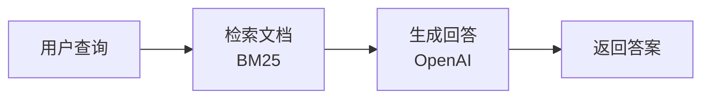
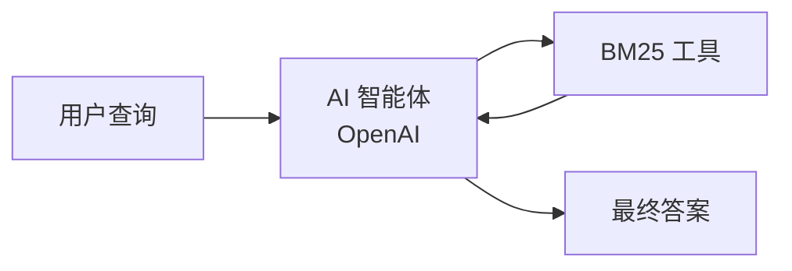

# 评估和改进 RAG 应用 { #how-to-evaluate-and-improve-a-rag-app }

本指南介绍如何使用 Ragas 评估 RAG（检索增强生成）应用，并通过迭代持续改进。

## 你将完成的工作 { #what-youll-accomplish }
- 准备评估数据集
- 建立衡量 RAG 表现的指标
- 构建可复用的评估流水线
- 分析错误，系统化改进 RAG 应用
- 使用 Ragas 开展 RAG 评估

## 配置并运行 RAG 系统 { #set-up-and-run-the-rag-system }

我们构建了一个简单的 RAG 系统，从 [Hugging Face 文档数据集](https://huggingface.co/datasets/m-ric/huggingface_doc)检索相关文档，再用 LLM 生成答案。该数据集以 Markdown 保存多个 Hugging Face 软件包的文档，为检验 RAG 能力提供丰富的知识库。

完整实现见 [ragas_examples/improve_rag/](https://github.com/vibrantlabsai/ragas/blob/main/examples/ragas_examples/improve_rag/)。



先安装运行依赖。

```bash
uv pip install "ragas-examples[improverag]"
```

然后运行 RAG 应用。

```python
import os
import asyncio
from openai import AsyncOpenAI
from ragas_examples.improve_rag.rag import RAG, BM25Retriever

# Set up OpenAI client
os.environ["OPENAI_API_KEY"] = "<your_key>"
openai_client = AsyncOpenAI()

# Create retriever and RAG system
retriever = BM25Retriever()
rag = RAG(openai_client, retriever)

# Query the system
question = "What architecture is the `tokenizers-linux-x64-musl` binary designed for?"
result = asyncio.run(rag.query(question))
print(f"Answer: {result['answer']}")
```
??? note "输出"
    ```python
    Answer: It's built for the x86_64 architecture (specifically the x86_64-unknown-linux-musl target — 64-bit Linux with musl libc).
    ```

??? example "理解 RAG 实现"
    上面的简单 `RAG` 类展示了核心工作流程。

    ```python
    # examples/ragas_examples/improve_rag/rag.py
    from typing import Any, Dict, Optional
    from openai import AsyncOpenAI

    class RAG:
        """Simple RAG system for document retrieval and answer generation."""

        def __init__(self, llm_client: AsyncOpenAI, retriever: BM25Retriever, system_prompt=None, model="gpt-4o-mini", default_k=3):
            self.llm_client = llm_client
            self.retriever = retriever
            self.model = model
            self.default_k = default_k
            self.system_prompt = system_prompt or "Answer only based on documents. Be concise.\n\nQuestion: {query}\nDocuments:\n{context}\nAnswer:"

        async def query(self, question: str, top_k: Optional[int] = None) -> Dict[str, Any]:
            """Query the RAG system."""
            if top_k is None:
                top_k = self.default_k

            return await self._naive_query(question, top_k)

        async def _naive_query(self, question: str, top_k: int) -> Dict[str, Any]:
            """Handle naive RAG: retrieve once, then generate."""
            # 1. Retrieve documents using BM25
            docs = self.retriever.retrieve(question, top_k)

            if not docs:
                return {"answer": "No relevant documents found.", "retrieved_documents": [], "num_retrieved": 0}

            # 2. Build context from retrieved documents
            context = "\n\n".join([f"Document {i}:\n{doc.page_content}" for i, doc in enumerate(docs, 1)])
            prompt = self.system_prompt.format(query=question, context=context)

            # 3. Generate response using OpenAI with retrieved context
            response = await self.llm_client.chat.completions.create(
                model=self.model,
                messages=[{"role": "user", "content": prompt}]
            )

            return {
                "answer": response.choices[0].message.content.strip(),
                "retrieved_documents": [{"content": doc.page_content, "metadata": doc.metadata, "document_id": i} for i, doc in enumerate(docs)],
                "num_retrieved": len(docs)
            }
    ```

    这就是 RAG 的基本流程：**检索相关文档 → 放入提示词 → 生成答案**。

## 创建评估数据集 { #create-evaluation-dataset }

这里使用 [huggingface_doc_qa_eval](https://huggingface.co/datasets/m-ric/huggingface_doc_qa_eval)，包含有关 Hugging Face 文档的问题与答案。

以下是部分样本。

| 问题 | 预期答案 |
|----------|----------------|
| `tokenizers-linux-x64-musl` 二进制文件面向哪种架构？ | x86_64-unknown-linux-musl |
| BLIP-Diffusion 模型的用途是什么？ | 用于可控的文生图与图像编辑。 |
| Datasets 服务器 API 的 /healthcheck 端点有什么用途？ | 确认应用正在运行。 |

评估脚本从[这里](https://raw.githubusercontent.com/vibrantlabsai/ragas/main/examples/ragas_examples/improve_rag/datasets/hf_doc_qa_eval.csv)下载数据，并转换为 Ragas Dataset 格式。

```python
# examples/ragas_examples/improve_rag/evals.py
import urllib.request
from pathlib import Path
from ragas import Dataset
import pandas as pd

def download_and_save_dataset() -> Path:
    dataset_path = Path("datasets/hf_doc_qa_eval.csv")
    dataset_path.parent.mkdir(exist_ok=True)

    if not dataset_path.exists():
        github_url = "https://raw.githubusercontent.com/vibrantlabsai/ragas/main/examples/ragas_examples/improve_rag/datasets/hf_doc_qa_eval.csv"
        urllib.request.urlretrieve(github_url, dataset_path)

    return dataset_path

def create_ragas_dataset(dataset_path: Path) -> Dataset:
    dataset = Dataset(name="hf_doc_qa_eval", backend="local/csv", root_dir=".")
    df = pd.read_csv(dataset_path)

    for _, row in df.iterrows():
        dataset.append({"question": row["question"], "expected_answer": row["expected_answer"]})

    dataset.save()
    return dataset
```

数据集的更多用法参阅[核心概念中的数据集](../../concepts/datasets.md)。

## 设置 RAG 评估指标 { #set-up-metrics-for-rag-evaluation }

数据集准备好后，需要指标衡量 RAG 表现。先选择简单、聚焦核心场景的指标。更多背景参阅[核心概念中的评估指标](../../concepts/metrics/index.md)。

这里使用离散指标 `correctness`，判断 RAG 回答是否包含预期答案中的关键信息，并且与给定上下文的事实一致。

```python
# examples/ragas_examples/improve_rag/evals.py
from ragas.metrics import DiscreteMetric

# Define correctness metric
correctness_metric = DiscreteMetric(
    name="correctness",
    prompt="""Compare the model response to the expected answer and determine if it's correct.

Consider the response correct if it:
1. Contains the key information from the expected answer
2. Is factually accurate based on the provided context
3. Adequately addresses the question asked

Return 'pass' if the response is correct, 'fail' if it's incorrect.

Question: {question}
Expected Answer: {expected_answer}
Model Response: {response}

Evaluation:""",
    allowed_values=["pass", "fail"],
)
```

定义指标后，需要在整个数据集上系统化运行，这正是 Ragas 实验的用途。

## 创建评估实验 { #create-the-evaluation-experiment }

实验函数在每条数据上运行 RAG 系统，再使用正确性指标评估回答。详情参阅[核心概念中的实验](../../concepts/experimentation.md)。

函数接收包含问题、预期上下文与预期答案的数据行，依次执行以下操作。

1. 使用问题查询 RAG 系统
2. 使用正确性指标评估回答
3. 返回包含得分和理由的详细结果

```python
# examples/ragas_examples/improve_rag/evals.py
import asyncio
from typing import Dict, Any
from ragas import experiment

@experiment()
async def evaluate_rag(row: Dict[str, Any], rag: RAG, llm) -> Dict[str, Any]:
    """
    Run RAG evaluation on a single row.

    Args:
        row: Dictionary containing question and expected_answer
        rag: Pre-initialized RAG instance
        llm: Pre-initialized LLM client for evaluation

    Returns:
        Dictionary with evaluation results
    """
    question = row["question"]

    # Query the RAG system
    rag_response = await rag.query(question, top_k=4)
    model_response = rag_response.get("answer", "")

    # Evaluate correctness asynchronously
    score = await correctness_metric.ascore(
        question=question,
        expected_answer=row["expected_answer"],
        response=model_response,
        llm=llm
    )

    # Return evaluation results
    result = {
        **row,
        "model_response": model_response,
        "correctness_score": score.value,
        "correctness_reason": score.reason,
        "mlflow_trace_id": rag_response.get("mlflow_trace_id", "N/A"),  # MLflow trace ID for debugging (explained later)
        "retrieved_documents": [
            doc.get("content", "")[:200] + "..." if len(doc.get("content", "")) > 200 else doc.get("content", "")
            for doc in rag_response.get("retrieved_documents", [])
        ]
    }

    return result
```

数据集、指标和实验函数都已准备好，可以开始评估系统表现。

## 运行初始 RAG 实验 { #run-initial-rag-experiment }

## 启动 MLflow 服务 { #start-mlflow-server }

评估前先启动 MLflow 服务。RAG 系统会自动将追踪记录发送到 MLflow，便于调试和分析。

```bash
# Start MLflow server (required - in a separate terminal)
uv run mlflow ui --backend-store-uri sqlite:///mlflow.db --port 5000
```

MLflow 界面位于 [http://127.0.0.1:5000](http://127.0.0.1:5000)。

## 运行初始 RAG 实验 { #run-initial-rag-experiment_1 }

运行完整评估流水线，建立 RAG 系统表现的基线。

```python
# Import required components
import asyncio
from datetime import datetime
from ragas_examples.improve_rag.evals import (
    evaluate_rag,
    download_and_save_dataset,
    create_ragas_dataset,
    get_openai_client,
    get_llm_client
)
from ragas_examples.improve_rag.rag import RAG, BM25Retriever

async def run_evaluation():
    # Download and prepare dataset
    dataset_path = download_and_save_dataset()
    dataset = create_ragas_dataset(dataset_path)

    # Initialize RAG components
    openai_client = get_openai_client()
    retriever = BM25Retriever()
    rag = RAG(llm_client=openai_client, retriever=retriever, model="gpt-5-mini", mode="naive")
    llm = get_llm_client()

    # Run evaluation experiment
    exp_name = f"{datetime.now().strftime('%Y%m%d-%H%M%S')}_naiverag"
    results = await evaluate_rag.arun(
        dataset,
        name=exp_name,
        rag=rag,
        llm=llm
    )

    # Print results
    if results:
        pass_count = sum(1 for result in results if result.get("correctness_score") == "pass")
        total_count = len(results)
        pass_rate = (pass_count / total_count) * 100 if total_count > 0 else 0
        print(f"Results: {pass_count}/{total_count} passed ({pass_rate:.1f}%)")

    return results

# Run the evaluation
results = await run_evaluation()
print(results)
```

脚本会下载数据集、初始化 BM25 检索器、逐条运行评估实验，并将详细结果保存为 `experiments/` 目录中的 CSV 文件。


??? note "输出"
    ```python
    Results: 43/66 passed (65.2%)
    Evaluation completed successfully!

    Detailed results:
    Experiment(name=20250924-212541_naiverag,  len=66)
    ```

本次通过率为 65.2%，可作为基线。`experiments/` 中的详细结果包含错误分析和系统化改进所需的数据。

### 在 MLflow 中查看追踪 { #viewing-traces-in-mlflow }

实验 CSV 为每次评估记录 `mlflow_trace_id` 和 `mlflow_trace_url`，便于查看详细执行过程，定位失败发生于检索、生成还是评估阶段。

RAG 系统会将追踪记录自动发送到先前启动的 MLflow 服务，可以在 [http://127.0.0.1:5000](http://127.0.0.1:5000) 查看。

你可以按以下方式分析。

1. **查看 CSV 结果**，阅读回答、指标得分和理由。
2. **深入检查追踪**，点击 `mlflow_trace_url`，直接打开该次评估在 MLflow 中的详细执行记录。

!!! tip "点击追踪链接进行调试"
    每条评估结果都包含可点击的 `mlflow_trace_url`，直接跳转到 MLflow 的详细追踪，无须手动查找或复制 ID。


## 分析错误与失败类型 { #analyze-errors-and-failure-modes }

检查 `experiments/` 中的 CSV，发现失败样本的规律。每行都包含 `mlflow_trace_id` 与 `mlflow_trace_url`，便于查看执行详情。为失败样本添加标注，理解错误模式，为改进提供依据。

### 本次评估中实际出现的失败模式 { #analysis-of-actual-failure-patterns-from-our-evaluation }

主要问题是**检索失败**，BM25 未找到包含答案的文档。模型正确遵循了“资料不足时应说明”的要求，但检索到的文档不正确。

**文档检索不佳的示例**
BM25 未能找到包含答案的相关文档。

| 问题 | 预期答案 | 模型回答 | 根因 |
|----------|----------------|----------------|------------|
| “create_repo 的默认仓库类型是什么？” | `model` | “给定文档未说明默认仓库类型……” | **BM25 遗漏 create_repo 相关文档** |
| “BLIP-Diffusion 模型的用途是什么？” | “可控的文生图与图像编辑” | “给定文档未提到 BLIP-Diffusion……” | **未检索到 BLIP-Diffusion 文档** |
| “Hugging Face 用来托管 scikit-learn 模型的新库叫什么？” | `Skops` | “给定文档未提到任何新的 Hugging Face 库……” | **BM25 遗漏 Skops 文档** |

分析表明，检索是主要瓶颈。下面作针对性改进。

## 改进 RAG 应用 { #improve-the-rag-app }

确定检索瓶颈后，可以从两类方法着手。

**传统方法**包括改进分块、采用混合检索或向量嵌入。本例中，BM25 单次查询经常遗漏相关文档，因此接下来探索**智能体方法**。

**智能体 RAG** 让 AI 迭代调整搜索策略，尝试多个搜索词，并判断上下文是否充分。

### 智能体 RAG 实现 { #agentic-rag-implementation }



运行智能体 RAG，测试示例查询。

```python
# Switch to agentic mode
rag_agentic = RAG(openai_client, retriever, mode="agentic")

question = "What architecture is the `tokenizers-linux-x64-musl` binary designed for?"
result = await rag_agentic.query(question)
print(f"Answer: {result['answer']}")
```

??? note "输出"
    ```python
    Answer: It targets x86_64 — i.e. the x86_64-unknown-linux-musl target triple.
    ```

??? example "理解智能体 RAG 实现"
    智能体 RAG 模式通过 OpenAI Agents SDK 创建 AI 智能体，为其提供 BM25 检索工具。

    ```python
    # Key components from the RAG class when mode="agentic"
    from agents import Agent, Runner, function_tool

    def _setup_agent(self):
        """Setup agent for agentic mode."""
        @function_tool
        def retrieve(query: str) -> str:
            """Search documents using BM25 retriever for a given query."""
            docs = self.retriever.retrieve(query, self.default_k)
            if not docs:
                return "No documents found."
            return "\n\n".join([f"Doc {i}: {doc.page_content}" for i, doc in enumerate(docs, 1)])

        self._agent = Agent(
            name="RAG Assistant",
            model=self.model,
            instructions="Use short keywords to search. Try 2-3 different searches. Only answer based on documents. Be concise.",
            tools=[retrieve]
        )

    async def _agentic_query(self, question: str, top_k: int) -> Dict[str, Any]:
        """Handle agentic mode: agent controls retrieval strategy."""
        result = await Runner.run(self._agent, input=question)
        print(result.answer)
    ```

    智能体自主决定何时搜索、如何搜索，尝试不同关键词组合，直到获得足够上下文。

## 重新运行实验并比较结果 { #run-experiment-again-and-compare-results }

接下来评估智能体 RAG 方案。

```python
# Import required components
import asyncio
from datetime import datetime
from dotenv import load_dotenv

# Load environment variables
load_dotenv()

from ragas_examples.improve_rag.evals import (
    evaluate_rag,
    download_and_save_dataset,
    create_ragas_dataset,
    get_openai_client,
    get_llm_client
)
from ragas_examples.improve_rag.rag import RAG, BM25Retriever

async def run_agentic_evaluation():
    # Download and prepare dataset
    dataset_path = download_and_save_dataset()
    dataset = create_ragas_dataset(dataset_path)

    # Initialize RAG components with agentic mode
    openai_client = get_openai_client()
    retriever = BM25Retriever()
    rag = RAG(llm_client=openai_client, retriever=retriever, model="gpt-5-mini", mode="agentic")
    llm = get_llm_client()

    # Run evaluation experiment
    exp_name = f"{datetime.now().strftime('%Y%m%d-%H%M%S')}_agenticrag"
    results = await evaluate_rag.arun(
        dataset,
        name=exp_name,
        rag=rag,
        llm=llm
    )

    # Print results
    if results:
        pass_count = sum(1 for result in results if result.get("correctness_score") == "pass")
        total_count = len(results)
        pass_rate = (pass_count / total_count) * 100 if total_count > 0 else 0
        print(f"Results: {pass_count}/{total_count} passed ({pass_rate:.1f}%)")

    return results

# Run the agentic evaluation
results = await run_agentic_evaluation()
print("\nDetailed results:")
print(results)
```

??? note "智能体 RAG 评估输出"
    ```python
    Results: 58/66 passed (87.9%)
    ```

通过率从基础方案的 65.2% 提升到智能体方案的 87.9%，提高了 22.7 个百分点。

### 表现比较 { #performance-comparison }

在本例中，智能体 RAG 相较基础方案有明显提升。

| 方案 | 正确率 | 提升 |
|----------|-----------|-------------|
| **基础 RAG** | 65.2% | - |
| **智能体 RAG** | **87.9%** | **+22.7 个百分点** |


## 将这一闭环用于自己的 RAG 系统 { #apply-this-loop-to-your-rag-system }

可以按以下流程改进 RAG 系统。

1. **创建评估数据集**，使用系统真实查询，或通过 LLM 生成合成数据。

2. **定义指标**，选择简单、聚焦场景的指标。

3. **运行基线评估**，衡量当前表现，分析错误规律，发现系统性问题。

4. **针对性改进**，根据分析优化检索（分块、混合搜索）、生成（提示词、模型），或尝试智能体方案。

5. **比较与迭代**，每次修改一项，与基线比较，直到准确率达到业务要求。

Ragas 自动完成调度与结果汇总，让你专注于分析和改进。
