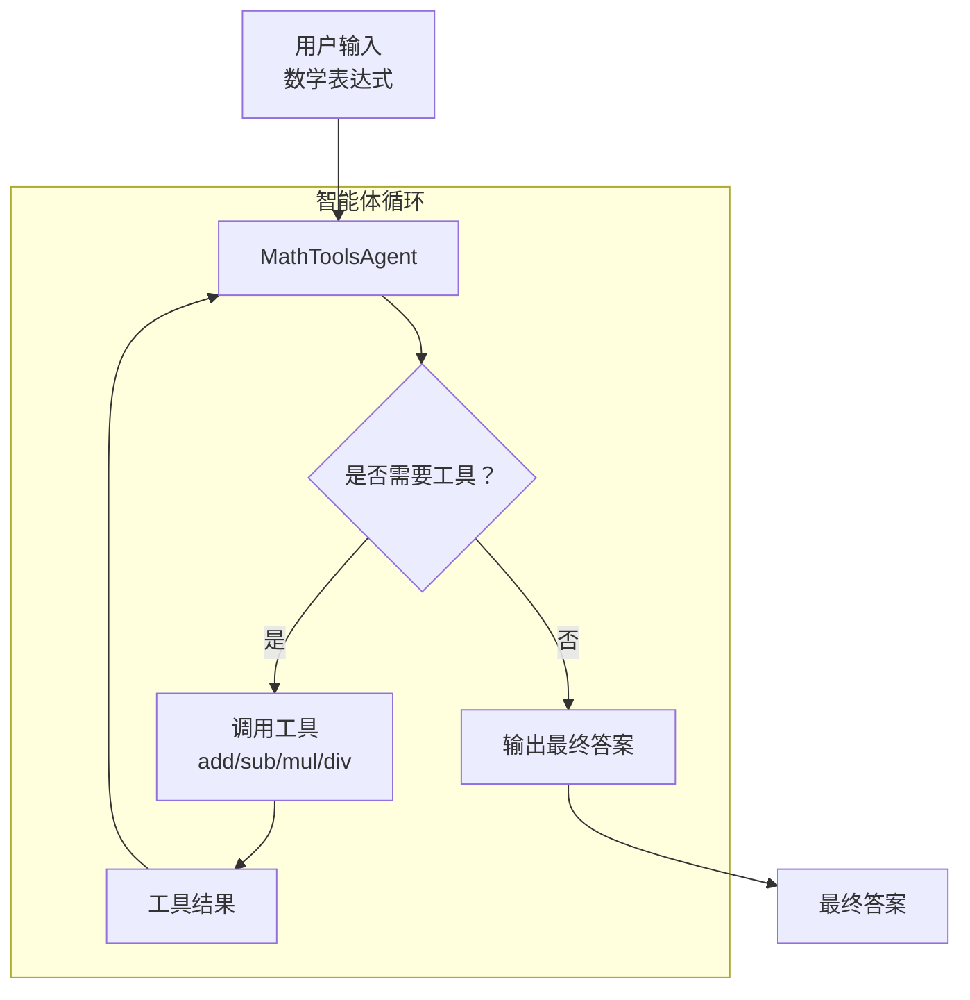

# 评估 AI 智能体 { #evaluate-an-ai-agent }

本教程使用 Ragas 评估一个数学智能体。它能够利用基本运算和函数调用能力求解复杂表达式。完成后，你将掌握如何通过评估驱动开发来评估和迭代智能体。



首先测试这个简单智能体，观察它如何通过基本运算与函数调用求解数学表达式。

```bash
python -m ragas_examples.agent_evals.agent
```

接下来，为智能体准备几组表达式和预期输出，并保存为 CSV 文件。

```python
import pandas as pd

dataset = [
    {"expression": "(2 + 3) * (4 - 1)", "expected": 15},
    {"expression": "5 * (6 + 2)", "expected": 40},
    {"expression": "10 - (3 + 2)", "expected": 5},
]

df = pd.DataFrame(dataset)
df.to_csv("datasets/test_dataset.csv", index=False)
```

为了衡量智能体的表现，我们将定义一个不依赖 LLM 的指标，检查其输出与预期结果的误差是否在允许范围内，并据此返回 1 或 0。

```python
from ragas.metrics import numeric_metric
from ragas.metrics.result import MetricResult

@numeric_metric(name="correctness")
def correctness_metric(prediction: float, actual: float):
    """Calculate correctness of the prediction."""
    if isinstance(prediction, str) and "ERROR" in prediction:
        return 0.0
    result = 1.0 if abs(prediction - actual) < 1e-5 else 0.0
    return MetricResult(value=result, reason=f"Prediction: {prediction}, Actual: {actual}")
```

然后编写实验循环，在测试数据集上运行智能体，用指标评估输出，并将结果保存为 CSV 文件。

```python
from ragas import experiment

@experiment()
async def run_experiment(row):
    expression = row["expression"]
    expected_result = row["expected"]

    # Get the model's prediction
    prediction = math_agent.solve(expression)

    # Calculate the correctness metric
    correctness = correctness_metric.score(prediction=prediction.get("result"), actual=expected_result)

    return {
        "expression": expression,
        "expected_result": expected_result,
        "prediction": prediction.get("result"),
        "log_file": prediction.get("log_file"),
        "correctness": correctness.value
    }
```

此后，每次修改智能体，都可以运行实验，观察改动对表现的影响。

## 端到端运行示例 { #running-the-example-end-to-end }

1. 设置 OpenAI API 密钥
```bash
export OPENAI_API_KEY="your_api_key_here"
```

2. 运行评估
```bash
python -m ragas_examples.agent_evals.evals
```

你已经使用 Ragas 完成了 AI 智能体评估！打开 `experiments/experiment_name.csv` 文件即可查看结果。
