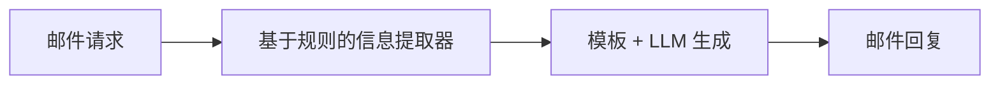

# 评估 AI 工作流 { #evaluate-an-ai-workflow }

本教程使用 Ragas 评估一个简单的自定义客服邮件分流工作流。完成后，你将掌握如何通过评估驱动开发来评估和迭代工作流。



首先测试这个简单工作流。它会从邮件中提取所需信息，路由到相应模板，再通过 LLM 生成回复。

```bash
python -m ragas_examples.workflow_eval.workflow
```


接下来，为工作流准备几组邮件查询和预期输出，并保存为 CSV 文件。

```python
import pandas as pd

dataset_dict = [
    {
        "email": "Hi, I'm getting error code XYZ-123 when using version 2.1.4 of your software. Please help!",
        "pass_criteria": "category Bug Report; product_version 2.1.4; error_code XYZ-123; response references both version and error code"
    },

    {
        "email": "I need to dispute invoice #INV-2024-001 for 299.99 dollars. The charge seems incorrect.",
        "pass_criteria": "category Billing; invoice_number INV-2024-001; amount 299.99; response references invoice and dispute process"
    }]
pd.DataFrame(dataset_dict).to_csv("datasets/test_dataset.csv", index=False)
```

为了衡量工作流的表现，我们将定义一个基于 LLM 的指标，比较工作流输出与通过标准，并返回通过或失败。

```python
from ragas.metrics import DiscreteMetric

my_metric = DiscreteMetric(
    name="response_quality",
    prompt="Evaluate the response based on the pass criteria: {pass_criteria}. Does the response meet the criteria? Return 'pass' or 'fail'.\nResponse: {response}",
    allowed_values=["pass", "fail"],
)
```

然后编写评估实验循环，在测试数据集上运行工作流，用指标评估输出，并将结果保存为 CSV 文件。

```python
from ragas import experiment

@experiment()
async def run_experiment(row):
    response = workflow_client.process_email(
        row["email"]
    )

    score = my_metric.score(
        llm=llm,
        response=response.get("response_template", " "),
        pass_criteria=row["pass_criteria"]
    )

    experiment_view = {
        **row,
        "response": response.get("response_template", " "),
        "score": score.value,
        "score_reason": score.reason,
    }
    return experiment_view
```

此后，每次修改工作流，都可以运行实验，观察表现的变化，并与此前结果比较，判断改动带来了提升还是退化。

## 端到端运行示例 { #running-the-example-end-to-end }
1. 设置 OpenAI API 密钥
```bash
export OPENAI_API_KEY="your_openai_api_key"
```

2. 运行实验
```bash
python -m ragas_examples.workflow_eval.evals
```

你已经使用 Ragas 完成了第一次评估！打开 `experiments/experiment_name.csv` 文件即可查看结果。
