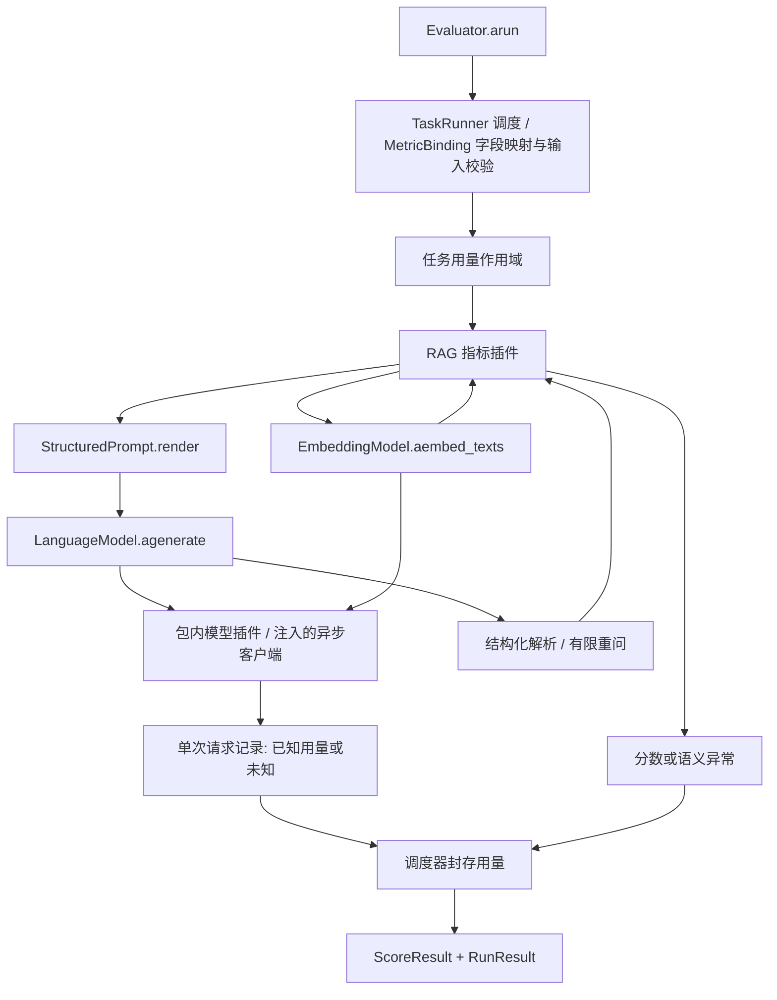

# 阶段 2：模型协议与首批 RAG 指标

更新于 2026-11-19。阶段 2 实现已在本地提交 `28a24de`。两项单轮 RAG 回答评分已在 Windows / Python 3.12.7 通过离线验收。现在可以向同一个 `Evaluator` 注入裁判和嵌入模型，通过 `arun` 取得每行的分数、原因和用量。[本轮验收记录](#本轮验收记录)

[按指标排序的实现清单](#11-分批实施与退出标准) · [迭代路线](roadmap.zh-CN.md) · [总设计](plugin-architecture.zh-CN.md) · [阶段 1](phase-1.zh-CN.md) · [项目介绍](../README.md)

实现约束见[代码风格与实现规范](implementation-standards.zh-CN.md)。下列目录和接口服务本阶段实际能力，不要求预建远期抽象；必要校验按边界归属，不在每一层重复。

## 1. 交付目标与范围

阶段 1 已提供数据集、字段绑定、插件注册、并发调度和结果导出。阶段 2 在这条链路上接入模型。调用者显式提供裁判模型和嵌入模型，通过一次 `await Evaluator(metrics).arun(dataset)` 在同一批数据上回答两个问题。

| 评测问题 | 交付指标 | 数据字段 | 评分依据 |
|---|---|---|---|
| 回答中的陈述有多少得到检索上下文支持？ | `FaithfulnessMetric` | `user_input`、`response`、`retrieved_contexts` | 裁判先拆陈述，再对照上下文判断，按返回判定计算支持比例 |
| 回答与用户问题有多相关？ | `AnswerRelevanceMetric` | `user_input`、`response` | 裁判从回答反推问题，用嵌入比较它们与原问题的相似度，并按回避标记计算最终得分 |

随主包交付两个指标插件、一个文本 Chat Completions 插件和一个文本嵌入插件。模型与嵌入各有独立协议，客户端由调用者创建和关闭。首批支持非流式文本生成，结构化输出模式为 `json_object` 和 `text`。默认运行依赖沿用 Pydantic，OpenAI SDK 只在使用相应客户端或执行 SDK 集成测试时安装。

用户可以从 `RunResult` 查到每行得分、失败或无定义的原因，以及按指标绑定汇总的已观测请求和用量。结果保留指标的评分版本，配置快照记录模板版本及模型配置。旧实现 `src/ragas/` 用于迁移对照，新包保持独立导入。检索评测与参考答案正确性的交付顺序见[三个功能版本](roadmap.zh-CN.md#单轮-rag-的三个功能版本)。

## 2. 本次确定的设计取舍

| 决策 | 实施约定 | 对原草稿的调整 |
|---|---|---|
| 中立接口 | LanguageModel、EmbeddingModel 只接收本包类型；保留 create_language_model、create_embedding_model 命名 | 与当前总设计统一，不额外增加同义工厂 |
| 模型配置 | 生成参数在构造时固定，逐次调用没有任意 **options | 配置快照对应实际请求；不依据模型名字猜参数 |
| 传输重试 | 首批插件关闭 SDK 自动重试，本阶段不自动重试网络/HTTP 失败 | 删除“失败请求通常不计费，因此统计正确”的假设 |
| 结构化重问 | 只由模型公共帮助类处理，默认最多重问 1 次，可设为 0 | 解析失败的已产生用量必须保留；不叠加 TaskRunner 重试 |
| 用量 | 每次 SDK 请求开始登记、结束归档；未知计为 None；结果明确完整性 | 不以已知部分冒充总量，不把未接入统计的自定义模型当零用量 |
| 并发 | 首批指标内部串行；当前运行的请求并发受 max_concurrency 约束 | 不承诺跨 Evaluator 的全局限流，也不把并发数当作 RPM/TPM 限额 |
| 空评分 | 新增 undefined，只用于算法语义下的无定义值 | 不把 malformed 模型输出或供应商拒答归入 undefined |
| 客户端生命周期 | 调用者拥有异步客户端；首批模型插件只支持在所属循环内异步使用 | 不以“连续两次 run 偶尔成功”作为跨循环复用承诺 |
| 迁移对照 | 固定环境中的提示词逐字节一致，评分和状态逐例对照 | 不承诺任意 Pydantic 版本下渲染字节都相同，也不承诺真实模型分数不变 |

选择 Chat Completions 是本次迁移范围的决定，不是对所有模型 API 的长期限制。后续实现其他供应商插件时，继续满足同一协议，不在内核增加厂商判断。

## 3. 目录与迁移账本

标记：**新增**＝旧项目没有该中立契约；**复制重构**＝只复制必要算法并调整接口；**修改**＝扩展阶段 1 已实现文件。目录中的文件按需要创建，不先放空实现。

```text
tallyjudge/
├── __init__.py                       # [修改] 导出两个模型工厂
├── api/factories.py                   # [修改] 两个模型工厂
├── core/
│   ├── prompts.py                    # [复制重构] Message、PromptInput、StructuredPrompt
│   ├── usage.py                      # [新增] Usage、UsageSummary、请求记录与任务统计
│   ├── errors.py                     # [修改] ModelError、ModelOutputError、UndefinedScore
│   ├── results.py                    # [修改] undefined、ErrorInfo.code、ScoreResult.usage
│   ├── aggregation.py                # [修改] 汇总 undefined 计数与每个绑定的用量
│   └── execution.py                  # [修改] 任务用量作用域、终态封存、异常分类
├── interfaces/
│   ├── models.py                     # [新增] 两个协议、结果类型、公共帮助类
│   └── metrics.py                    # [修改] 非空字段校验的可读 expected
├── registry/
│   ├── specs.py                      # [修改] 声明工厂接收的注入对象
│   ├── registry.py                   # [修改] 按 kind 创建、配置与对象分离
│   └── builtins.py                   # [修改] 登记四个插件
└── plugins/
    ├── _openai_compatible.py          # [新增] 客户端视图、实际请求和用量映射
    ├── models/openai_compatible.py    # [新增适配] 异步 Chat Completions
    ├── embeddings/openai_compatible.py # [复制重构] 批量文本嵌入
    └── metrics/rag/
        ├── faithfulness.py           # [复制重构+改名] 算法、提示词及其输出模型
        └── answer_relevance.py       # [复制重构+改名] 算法、提示词及其输出模型

tests/tallyjudge/
├── conftest.py                       # 可编排响应的离线客户端
├── unit/test_model_plugins.py         # 输入、重问、用量边界和并发隔离
├── contracts/test_registry.py         # 注册和延迟加载
├── installation/{test_installation,wheel_probe}.py
├── migration/test_rag_baselines.py    # 评分、请求顺序与提示词回归
└── integration/test_openai_sdk.py     # 真实 SDK + 本地模拟 HTTP；无需密钥

tools/migration/generate_rag_baselines.py # 只在旧环境生成对照数据
```

| 来源 | 目标 | 变化与保留事项 |
|---|---|---|
| [Faithfulness](../src/ragas/metrics/collections/faithfulness/metric.py) 及同目录 util.py | FaithfulnessMetric | 保留两步算法与提示词；去掉 Instructor 类型检查 |
| [AnswerRelevancy](../src/ragas/metrics/collections/answer_relevancy/metric.py) 及 util.py | AnswerRelevanceMetric | 统一 Relevance 命名；用标准库计算余弦，不复制 NumPy 依赖 |
| [BasePrompt.to_string](../src/ragas/prompt/metrics/base_prompt.py) | StructuredPrompt.render | 保留指令、示例、字段描述、Schema 和渲染顺序；不迁移 adapt/翻译 |
| [InstructorBaseRagasLLM](../src/ragas/llms/base.py) | LanguageModel + LanguageModelBase | 重构，返回 GenerationResult.data；不沿用 Instructor 包装器 |
| [OpenAI 嵌入](../src/ragas/embeddings/openai_provider.py) | OpenAICompatibleEmbeddingModel | 参考批量请求方式；返回 EmbeddingResult，包含用量 |
| llm_factory / embedding_factory | create_language_model / create_embedding_model | 显式插件 ID 与依赖注入，不推断供应商或默认模型 |
| 阶段 1 的 `registry.describe(metric_id)` | 继续返回 `MetricSpec` | 复用现有查询方法，新指标与文本指标同样通过 `.inputs` 提供字段 |

旧基线固定为 ec003395bb37c223fc981e6567162513aec52a71。保留 d7a8b63 的二元 verdict 约束和 209f557 的字符串上下文拒绝行为。旧代码已经包含这些修复，不重复搬运兼容层。

## 4. 调用链与接口



### 公共契约

下面列出模型插件使用的字段和方法。完整签名见[模型协议](../tallyjudge/interfaces/models.py)。

```python
@dataclass(frozen=True)
class Message:
    role: Literal["system", "user", "assistant"]
    content: str

@dataclass(frozen=True)
class PromptInput:
    messages: tuple[Message, ...]
    @classmethod
    def from_text(cls, text: str) -> "PromptInput": ...

@dataclass(frozen=True)
class Usage:
    input_tokens: int | None = None
    output_tokens: int | None = None

@dataclass(frozen=True)
class GenerationResult[T]:
    data: T
    usage: UsageSummary
    model: str | None              # 服务端实际返回的模型名

@dataclass(frozen=True)
class EmbeddingResult:
    vectors: list[list[float]]
    usage: UsageSummary
    model: str | None

class LanguageModel(Protocol):
    @property
    def plugin_id(self) -> str: ...
    @property
    def usage_tracking(self) -> Literal["per_request", "untracked"]: ...
    def config_snapshot(self) -> dict[str, Any]: ...
    async def agenerate[T: BaseModel](
        self, prompt: PromptInput, response_model: type[T]
    ) -> GenerationResult[T]: ...

class EmbeddingModel(Protocol):
    @property
    def plugin_id(self) -> str: ...
    @property
    def usage_tracking(self) -> Literal["per_request", "untracked"]: ...
    def config_snapshot(self) -> dict[str, Any]: ...
    async def aembed_texts(self, texts: Sequence[str]) -> EmbeddingResult: ...
```

- PromptInput.from_text 只创建一条 user 消息。提示词和传输消息均使用本包类型，不引入框架 Message。
- `LanguageModelBase.agenerate` 负责解析和结构化重问。Chat 插件的 `_acomplete` 检查停止原因并返回文本和服务端模型名。生成与嵌入共用的传输层在每次 SDK 调用处登记用量，生成失败时也保留已经产生的记录。
- 嵌入插件直接实现 `aembed_texts(texts)`。原问题以单元素列表传入，反推的问题按批传入，两者共用请求记录逻辑。
- 两个协议不要求继承基类。自定义模型可直接实现协议；usage_tracking 声明是否遵循请求记录契约，未知标为 untracked，不能假定为零。
- 阶段 2 不新增同步 generate/embed 方法。纯本地指标仍支持阶段 1 的 score/run；使用注入异步客户端的模型指标以 await ascore/arun 为支持入口。

### 提示词与生成参数

StructuredPrompt 声明输入/输出 Pydantic 模型、instruction、examples，render 返回 PromptInput。旧模型类名参与 JSON Schema 的 title 和引用，因此这些内部输出类不随公开 Metric 类一起改名。

保持原渲染格式，包括换行、空格、JSON 转义和示例顺序；输入校验的非空约束放在 MetricSpec 的 Annotated[..., Field(min_length=1)] 中，不修改旧提示词输出 Schema。保留原来的“空串”判定，不擅自 strip 空白；上下文列表非空不等于每个元素都必须非空。

固定 Pydantic 2.14.3 时，按旧环境得到的 SHA-256 核对三段提示词的完整字节。其他支持版本只归一化输出 Schema 的 JSON 键顺序与无意义空白，指令、示例、样本和消息顺序仍参与校验。模板或输出 Schema 有意变化时，同时更新 `prompt_revision`、评分 `revision` 和相应断言。

输入严格校验与模型输出解析分开：旧输出模型继续按原 Pydantic 默认规则解析。verdict 仅允许解析后的 0/1；字符串 "1"、true、1.0 的旧行为必须由固定用例验证，不扩大为“任意模型输出都宽松”。

## 5. 注册与对象注入

PluginSpec 增加静态 dependencies 声明，依赖种类仅为 language_model、embedding_model、client。配置与依赖不能同名；依赖值从 create 参数中取出，其余交给 config_type 严格验证。缺少依赖在网络请求之前报错。

- create_metric 只接受 metric；create_language_model 只接受 model；create_embedding_model 只接受 embedding。通用 registry.create 保留按 ID 分派。
- 检查模型依赖是否提供协议所需成员，不用继承特定基类作为条件。具体网络客户端的协议检查留在所选插件，不在核心遍历 SDK 类型。
- `list(kind=...)` 返回静态 `PluginSpec`。`describe(metric_id)` 继续返回 `MetricSpec`。模型配置由对应工厂声明，模型和嵌入的选择可通过各自的 kind 查询。
- 依赖对象从不传入 Pydantic JSON 配置模型。快照由插件显式组装，不对客户端 __dict__ 做“排除敏感键后序列化”。
- 保留阶段 1 对重复 ID、API 版本、未知参数和异常链的处理。契约测试继续从现有查询入口读取文本及 RAG 指标的输入字段。

| kind | ID | 必需注入对象 |
|---|---|---|
| model | model.openai_compatible.chat_completions | client |
| embedding | embedding.openai_compatible.embeddings | client |
| metric | metric.rag.faithfulness | llm |
| metric | metric.rag.answer_relevance | llm、embeddings |

快照示意：

```json
{"strictness": 3, "prompt_revision": "1", "llm": {"plugin_id": "model.openai_compatible.chat_completions", "config": {"model": "judge-deployment", "endpoint_id": "local-eval", "structured_output": "json_object", "temperature": 0.01, "request_timeout": 60, "structured_retries": 1}}}
```

endpoint_id 是调用者提供的非敏感部署标签，不能宣称它足以复原部署；客户端的 base_url、密钥、headers 和对象引用均不导出。固定配置快照可比较，实际模型输出不保证可重现。

### 调用示例

客户端在当前 async 函数所属循环中创建，并由调用者在外层关闭；下面函数接收该客户端，不负责资源所有权。

```python
from tallyjudge import Dataset, Evaluator, create_metric
from tallyjudge.api.factories import create_language_model, create_embedding_model

async def evaluate_rag(client, judge_model: str, embedding_model: str):
    judge = create_language_model(
        "model.openai_compatible.chat_completions",
        client=client, model=judge_model, endpoint_id="evaluation",
        temperature=0.01,  # 显式写出；None 表示使用服务端默认值
    )
    embeddings = create_embedding_model(
        "embedding.openai_compatible.embeddings",
        client=client, model=embedding_model, endpoint_id="evaluation",
    )
    metrics = [
        create_metric("metric.rag.faithfulness", llm=judge),
        create_metric("metric.rag.answer_relevance", llm=judge,
                      embeddings=embeddings, strictness=3),
    ]
    dataset = Dataset.from_records([{
        "case_id": "example-1", "user_input": "法国的首都是哪里？",
        "response": "巴黎。", "retrieved_contexts": ["法国的首都是巴黎。"],
    }])
    return await Evaluator(metrics).arun(dataset)
```

模型工厂也由包根导出。创建和关闭 `AsyncOpenAI` 客户端的完整脚本见 [README 示例](../README.md#单轮-rag-评测)。

## 6. 首批供应商适配

### Chat Completions

| 配置 | 默认值 / 约束 |
|---|---|
| model | 必填非空字符串，部署名也显式填写 |
| endpoint_id | 可选非敏感标签 |
| structured_output | json_object；可选 text，不自动降级 |
| temperature、top_p | None；None 表示不发送，不照搬旧 SDK 对模型家族的推断 |
| max_output_tokens | None 或正整数；旧版 1024 仅作为迁移配置示例 |
| token_limit_param | max_tokens；调用者可显式选 max_completion_tokens |
| request_timeout | 60 秒，有限正数；单次 SDK 请求预算，不替代任务总 timeout |
| structured_retries | 默认 1，非负整数；总生成请求数上限为 1 + 该值 |

迁移提示：旧版 InstructorModelArgs 默认发送 temperature=0.01、top_p=0.1、max_tokens=1024。新插件的默认值为 None，表示不发送这些参数，由服务端默认值决定（常见的 temperature 为 1.0），裁判输出的稳定性可能下降。迁移说明和所有示例都要显式写出 temperature；冒烟记录也要写明实际使用的生成参数。不同时发送 temperature 和 top_p，因为部分兼容端点不接受二者同时出现。

暂不开放 extra_body、任意请求 kwargs、额外 system_prompt 或参数名猜测。确有供应商扩展需求时增加有名称、有快照的配置项，避免未知字段覆盖 model、messages 或泄漏凭据。

客户端契约：注入对象支持 with_options(max_retries=0, timeout=...) 及可 await 的 chat.completions.create/embeddings.create；插件使用带覆盖选项的客户端视图，不修改和关闭原对象。无法满足此契约的客户端用单独适配插件接入，不静默放任隐藏重试。不开私有属性反射，也不以 iscoroutinefunction 作为唯一判断标准。

SDK 官方说明提供关闭重试及按请求配置选项的方式；实施时用真实 SDK 的模拟传输测试验证仅一次 HTTP 尝试，不能只检查假对象的调用次数。[OpenAI Python SDK](https://github.com/openai/openai-python#retries)

json_object 请求显式指定 JSON 输出，text 请求不发送 response_format。只在整个输出恰好是一层 JSON Markdown 围栏时剥掉围栏，不从任意解释文字中猜测 JSON。两种模式均经同一输出模型验证。

- 成功收到文本后先记用量，再解析；解析失败可以重问。
- 重问追加本轮 assistant 文本与简短 user 修正说明。修正说明只使用失败字段路径与错误类型，不直接拼接 Pydantic 完整报错。重问消息仅存在于当前调用，不写结果。
- 空内容、截断、明确拒答、意外 tool_calls、非单一 choice、非法响应形状：ModelOutputError，原因码分别固定，不自动换模式或重问。
- HTTP/连接异常：ModelError，保留原异常链和原类名；不重试，不因错误消息匹配字符串猜供应商行为。
- CancelledError 原样传播；没有 response 时用量未知，不能推定未计费。

本阶段不做传输重试，带来的使用限制需要写进文档：触发限流（429）或遇到瞬时 5xx 的样本会直接记为 error/model_error，不会自动补跑。
- 调用者应先用较小的 max_concurrency 试跑，确认端点的限额。
- 失败样本可以按 case_id 从 RunResult.inputs 中筛出，重新构建 Dataset 后再评一次。

json_schema 延后，是因为普通 Pydantic Schema 不等于供应商接受的严格 Schema。后续需要单独的能力声明及转换测试，不能仅传 model_json_schema 并设置 strict。[结构化输出支持范围](https://developers.openai.com/api/docs/guides/structured-outputs)

### 嵌入

配置为 model、endpoint_id、request_timeout、batch_size（默认 256，正整数）、dimensions（可选正整数）。不声称所有端点都支持同一批量上限或 dimensions。

空 texts 返回 vectors=[] 和零请求的用量汇总，不发网络请求。非空输入按顺序分批；每批显式请求数值向量格式，结果 index 必须恰好覆盖 0..batch_length-1 且无重复，然后恢复输入顺序。各批、各向量维度必须一致，且满足显式 dimensions；拒绝空向量、bool、非数值或非有限元素。数据形状错误只在插件响应边界校验一次。

批次 1 成功、批次 2 失败时不返回部分向量冒充完整成功，但已发生的请求与用量必须进入任务记录。不得把所有批次用量只放在最终成功结果上。

### 循环与资源所有权

客户端由调用者创建和关闭，两个插件可共享客户端。构造不发请求；插件第一次实际请求时绑定当前循环，后续跨循环使用在发请求前明确报错。同步 run 每次创建新循环，因此对这类插件不承诺反复复用；所有正式示例使用一个 asyncio.run(main())，在 main 内创建客户端、连续 await arun、最后关闭客户端。

该限制不加入供应商无关 LanguageModel 协议，纯 Python 假模型不受影响。集成测试验证同循环多次运行、取消后复用和跨循环明确失败；不通过在工作线程里另建循环来掩盖连接池生命周期。

## 7. 请求记录、未知用量与封存

### 唯一统计来源

core.usage 提供请求记录作用域和任务累加器（ContextVar），不引入事件总线。内置生成和嵌入插件在共用的 `ClientTransport.send` 中登记每次实际 SDK 调用，成功、异常或取消时结束记录。返回的 UsageSummary 直接读取同一份记录。

非继承实现可使用同一请求记录帮助函数，并声明 usage_tracking="per_request"。RAG 指标在实际调用依赖前，通过 mark_usage_source 登记它的 plugin_id 和 tracking 声明；该动作只标记来源，不记请求、不统计 tokens。untracked 模型不能被自动推断出请求数，记录在 untracked_sources 中；缺少追踪声明的依赖在构造时不满足协议。契约测试验证声明 per_request 的内置插件确实覆盖失败和取消路径。

请求记录只存归一化用量、类别与完成情况，不存 prompt、生成文本、向量或 SDK 原始响应。没有任务上下文时，直接 agenerate/aembed_texts 仍能返回本次调用的汇总；使用局部记录，不共享全局可变计数器。

### 序列化语义

ScoreResult.usage 为 None（未观测到请求且无 untracked 来源）或包含 generation、embedding 两个 UsageSummary 以及 untracked_sources 的对象。每个 UsageSummary 包含：

- requests：本包已观测到的请求尝试数，包括失败和取消；不是计费账单，也不包含未知模型内部的请求数。
- requests_without_usage：完全没有收到用量对象的请求数。
- in_flight_requests：终态封存时尚未完成的请求数。
- complete：没有未完成请求、所有请求都返回了用量对象且没有 untracked 来源；每个 token 字段是否完整仍以下述 known_counts 判断。
- known_tokens：各 token 字段的已知部分合计；该字段一个已知值都没有时为 None。
- known_counts：每个 token 字段有明确数值的请求数。调用方只有在它等于 requests 时，才能把该字段合计视为完整的已观测总量。

例：两次请求的 input_tokens 分别为 10 和未知，则 requests=2、known_tokens.input_tokens=10、known_counts.input_tokens=1，不能把 10 标成总消耗。零请求时 known_tokens 全为 None；某次服务明确返回 0 时该数值是已知的 0。嵌入的 output_tokens 若服务不提供，也保持 None。

首版统计输入和输出 token。服务明确返回的非负整数计入已知值，缺失或非法字段记未知，其他有效字段和评分保留。缓存与推理 token 细分随费用分析设计。

### 超时与取消

调度器写入任务终态时封存累加器：复制当时的已知记录，标识进行中的请求，不等待计费回执。ContextVar 在 finally 中 reset；同一上下文中创建的子任务可共享累加器，但其迟到写入在封存后不会进入结果。保留阶段 1 的有界清理、原样取消传播、cleanup_warnings、not_started 以及 run_status/stop_reason。

进入请求记录作用域时检查它是否已封存：若已封存，不允许残留的内置指标在吞取消后继续发起下一次网络请求。此时抛出内部的 UsageScopeClosed 异常（不继承 CancelledError），不发请求。由于该任务已有终态，这个异常只出现在被放弃任务的本地日志中，不进入结果。已经提交给服务的请求无法据此撤销，其最终用量仍可能未知。自定义 untracked 客户端的外部行为不受本包保证。

每绑定 summary 增加相同语义的 usage 汇总，known_counts/requests 按来源类别相加，untracked_sources 去重；不对部分和补零。不新增第二套费用或 token 统计，也不在本阶段估价。

## 8. 两个指标的评分与迁移差异

两个指标初始 revision="1"，不沿用旧包版本号。非空约束声明在 MetricSpec；expected 保留注解描述，不写用户输入值。`validate_inputs` 从注解生成可读描述。`Annotated[str, Field(min_length=1)]` 对应 `non-empty str`，非空上下文列表对应 `non-empty list[str]`。这两种 RAG 指标在具名 `ascore` 和 `Evaluator` 路径各校验一次，失败时尚未发送请求。类型错误、缺字段和空输入继续使用阶段 1 的 validation_error + field/expected，不逐行打印 ERROR traceback。

### FaithfulnessMetric

输入 user_input: 非空 str、response: 非空 str、retrieved_contexts: 非空 list[str]；依赖 llm；值域 [0,1]。

1. 用原 StatementGeneratorPrompt 拆陈述。
2. 上下文按原顺序用单个换行连接，用原 NLIStatementPrompt 判断。
3. 得分为返回判定中 verdict=1 的条数 / 返回判定总条数。

| 边界 | 旧行为 | 本阶段处理 |
|---|---|---|
| 字符串上下文 | ValueError | 严格 list[str] 校验，error/validation_error |
| 空问题、回答、上下文列表 | ValueError | 非空注解校验，error/validation_error；空白字符串不额外拒绝 |
| 陈述列表为空 | NaN | undefined，code=no_statements |
| 判定列表为空 | NaN | undefined，code=no_verdicts |
| 判定数量与陈述数量不一致 | 按返回的判定数量计算 | 保留公式，记录一条不含原文的 WARNING；修正分母须另立评分 revision |
| verdict 解析后不是 0/1 | 输出校验失败 | 保留二元约束；重问耗尽为 error/model_output_error |

不以字符串相等强制配对陈述，不顺便改变重复陈述处理，不新增早停模型请求来改变迁移行为。

### AnswerRelevanceMetric

输入 user_input、response 均为非空 str；依赖 llm、embeddings；strictness 默认 3，为正整数，不设置缺乏算法依据的 10 次上限；值域 [-1,1]。

串行生成 strictness 个问题，只保留非空 question 及其 noncommittal 标记。原问题请求一次嵌入，生成问题再进行一次逻辑批量嵌入（供应商批次可能多于一次请求）。计算余弦均值，乘以 int(not all(noncommittal_flags))。

| 边界 | 本阶段处理 |
|---|---|
| 所有生成问题为空 | 保留 success/0.0，不调用嵌入 |
| 只有部分问题非空 | 只使用保留下来的问题及对应标记；分母是实际保留数 |
| 全部 noncommittal 非零 | 保留旧流程：仍请求嵌入、计算后乘 0；不提前省略这些请求 |
| 任意非零整数 noncommittal | 按旧 truthiness 处理，输出 Schema 不偷偷加二元约束 |
| 负余弦 | 保留负分，不截成 [0,1] |
| 任意零向量 | undefined，code=zero_norm_embedding；即使全部回避也不伪造 0 分 |
| 维度不一致或非有限向量 | error/model_output_error，由嵌入响应边界或跨调用维度检查发现 |

余弦使用标准库 math.hypot、math.fsum 和归一化向量计算，避免原始点积/平方溢出。与 NumPy 旧基线的比较仅在有效有限向量上使用绝对容差 1e-12、相对容差 0。因舍入略超过 [-1,1] 且差值不超过 1e-12 时归回边界，登记为数值修正；超出该范围仍 invalid_output。不把容差扩散到其他指标、状态、提示词或输入。

## 9. 状态与错误映射

| 情况 | ScoreResult.status / ErrorInfo.category | 诊断 |
|---|---|---|
| 请求参数/样本不合规 | error / validation_error | field、expected，沿用 WARNING/DEBUG 分级 |
| HTTP、认证、限流、连接失败 | error / model_error | exception_type 是原 SDK 异常类名；保留本地异常链 |
| 输出截断、拒答、缺内容、解析耗尽、向量形状错误 | error / model_output_error | ErrorInfo 新增 code，用稳定原因码区分，不填虚构 exception_type |
| 有效模型结果导致算法无定义 | undefined / undefined_score | code 为 no_statements、no_verdicts 或 zero_norm_embedding；value=None，不参与均值 |
| 指标直接返回 NaN/Inf | invalid_output | 沿用阶段 1，不转成 undefined |
| 任务超时、外部取消、未启动 | timeout/cancelled/not_started | 沿用阶段 1，保留已封存用量 |

ErrorInfo 的分工：category 表示大类（validation_error、model_error、model_output_error、undefined_score 等），code 表示稳定的细分原因。不把细分原因写进 category，这样按 category 统计时类别数量固定，新增原因只需增加 code。ModelOutputError 的 code 至少覆盖 invalid_json、schema_validation、empty_content、truncated、refusal、unexpected_response、invalid_embedding。它和 ModelError 会触发 raise 模式停止；undefined 和 invalid_output 不触发。undefined 是已执行的终态，不改变 run_status：record 模式全部处理后仍为 completed。

ModelError 不把原异常消息写进结果；ModelOutputError 也不携带完整模型原文到结果。完整诊断留在显式本地日志；DEBUG 可能包含敏感内容，沿用阶段 1 的说明。schema v1 未发布，本阶段增加 code、undefined、usage 时同步更新序列化和安装测试，不悄悄更改既有字段含义。

## 10. 旧基线、验证层次与通过条件

### 基线生成

在 ec00339 的独立旧环境中运行 generate_rag_baselines.py，不给新包安装旧依赖。脚本化裁判继承旧 InstructorBaseRagasLLM，仅替代请求返回；确定性嵌入继承旧 BaseRagasEmbedding。记录收到的完整提示词、调用顺序、JSON 输出和请求到的文本，不只记录最终分数。

旧环境可将来源、版本、合成输入、完整提示词、旧分数或异常输出到临时报告。日常测试使用合成响应和显式的得分、状态与请求顺序断言，干净检出即可运行。

旧环境使用 Python 3.12.7、Ragas 0.4.4、Pydantic 2.14.3 和 NumPy 2.5.4。13 个用例覆盖旧版分数及有意改变的状态语义。三段原提示词在测试中各保留字节摘要与 Schema 归一化摘要。[RAG 迁移回归](../tests/tallyjudge/migration/test_rag_baselines.py)

### 验证矩阵

| 层次 | 必须证明 |
|---|---|
| 默认离线单元测试 | 假客户端下两种输出模式、次数上限、空内容/截断/拒答、传输异常、取消；不用 SDK 或密钥 |
| 模型协议契约 | 假模型和内置实现均满足协议；注册配置/依赖分离；describe 不构造客户端 |
| 指标迁移 | Faithfulness 全支持/部分支持/空列表/数量不匹配；AnswerRelevance strictness 1/3、部分/全部回避、空问题、负分、零向量；中文提示词 |
| 用量归属 | 解析失败后的成功、重问耗尽、嵌入第二批失败、取消发生在请求前/进行中/响应后；仅部分字段已知；untracked 来源；迟到写入和封存后请求被阻止 |
| SDK 离线集成 | 真实 AsyncOpenAI + MockTransport 验证请求体、index 还原、429/500 仅一次 HTTP 尝试、异常链、客户端没有被插件关闭、同循环重复运行与跨循环拒绝 |
| schema 回归 | 沿用原有运行状态、未启动状态、空覆盖率和 WARNING 脱敏。检查 undefined、usage、code 的 JSON 往返，Annotated 输入的可读 expected 及快照中的模板版本 |
| 安装隔离 | 默认 wheel 不安装、不导入 OpenAI/Instructor/NumPy；选择已注入假客户端可完成两个 RAG 指标 |

SDK 集成依赖只进入 pyproject 的独立 integration 组，不进入运行依赖。先验证 openai 2.x 的一个固定版本及其实际 HTTP 传输依赖，记录版本并在 CI 固定；没有测试证据前不声明覆盖整个 1.x～2.x 范围。默认测试可跳过该组，独立 CI job 必须实际执行，不能全跳过仍称通过。

真实端点冒烟单独手动执行，使用调用者提供的端点/模型/密钥；不把它放入普通 PR 必过条件，不在本次设计阶段创建付费调用或自动发布流程。记录模型、endpoint_id、配置、请求数、状态和用量完整性，不与旧版真实分数作等价承诺。没有可用凭据时，将此项标为未验证，不阻塞离线架构验收，也不能宣布供应商生产验证完成。

## 11. 分批实施与退出标准

阶段 2 交付第一个 RAG 功能版本。按指标组织改动，每条评分链路都有自己的旧版基线、模型适配和离线验收。两条链路都复用阶段 1 的 `Dataset`、`MetricBinding`、`Evaluator.arun` 和 `RunResult`。

### 先跑通有依据的回答评分

- [x] 在 `ec00339` 的独立旧环境运行 Faithfulness，从实际输出取得拆陈述和上下文判定的提示词摘要、请求顺序、分数与异常。固定 Pydantic 版本核对提示词字节，测试直接声明预期结果。
- [x] 接通 `LanguageModel.agenerate`、`create_language_model` 和 Chat Completions 插件。让 `create_metric("metric.rag.faithfulness", llm=judge)` 能显式注入裁判。沿用 `registry.describe(metric_id).inputs` 读取指标参数，阶段 1 的文本指标继续使用原工厂。
- [x] 迁移拆陈述与上下文判定。沿用输入校验、超时与取消，在实际生成请求处记录已观测用量。将空陈述或空判定记为 `undefined`，将传输或解析失败记为 `error`，用量在行终态封存。

验收从公共入口运行一行有三条陈述、只返回两条判定 `[1, 0]` 的样本，应得到 `0.5`。用假裁判断言两次生成的参数与顺序，再用真实 SDK 配本地模拟 HTTP 检查请求体、结构化重问及 429 的单次传输。取消后读取部分快照，迟到响应不得改写行状态或用量。

### 再接入嵌入与回答相关性

- [x] 在相同旧环境核对 AnswerRelevancy 的第三段提示词、反推问题及固定向量。接通 `EmbeddingModel.aembed_texts`、`create_embedding_model` 与嵌入插件，单条和批量文本共用该方法。
- [x] 迁移为 `AnswerRelevanceMetric` 并登记 `metric.rag.answer_relevance`。保留 strictness、空问题、回避处理和负分，用标准库算余弦。单独验证乱序向量、零向量及第二批请求失败时已知用量的归属。
- [x] 在仓库外安装默认 wheel，用注入的假客户端让两个 RAG 指标同批运行。核对每行分数、原因码、覆盖率、评分版本及用量，与阶段 1 文本回归和固定版本的真实 SDK 离线集成一起验收。补充可运行的异步示例和迁移差异。

该版本的业务验收同时包含成功、语义无定义和模型失败三类样本。生成问题全空应得 `0.0`，零向量应为 `undefined`。失败行保留输入身份。真实端点的支持范围按实际运行的端点、模型与配置单独登记。

### 本轮验收记录

| Windows / Python 3.12.7 | 实际结果 |
|---|---|
| 默认开发环境 | 160 项通过。SDK 集成模块和 NumPy 专用用例按依赖跳过。 |
| 加装固定测试依赖 | 167 项通过。包含 13 个旧版 RAG 对照用例和 6 个使用 OpenAI 2.54.0、HTTPX 0.28.1 的模拟 HTTP 测试。 |
| 静态检查 | Ruff 检查和格式检查通过，Pyright 零错误、零警告。 |
| 仓库外安装 | 从 sdist 构建 wheel，在干净环境安装后运行两个文本指标和两个 RAG 指标。核对输入错误、无定义、有效零分、评分版本、覆盖率及用量。默认安装只直接依赖 Pydantic。 |

取消发生在第二次请求时，首个响应的已知 token 和正在进行的请求分别保留。其他行、绑定和迟到响应不会修改这些数值。模拟 HTTP 覆盖真实 SDK 的请求体、429/500 的单次传输和同一客户端取消后的复用。远程 CI 及真实服务端点有待另行验证。[SDK 集成测试](../tests/tallyjudge/integration/test_openai_sdk.py)

## 12. 首个 RAG 目标的后续版本

第二个功能版本迁移上下文精度和召回，第三个迁移与参考答案的语义相似度和答案正确性。它们共用本阶段的模型协议、错误状态和基线方法。每版的必交指标、旧版对照和整个目标的验收条件见[迭代路线](roadmap.zh-CN.md#单轮-rag-的三个功能版本)。

其他 RAG 指标继续保留在能力表。费用明细、跨次实验比较和持久化随运行管理阶段设计，独立 Streamlit 界面另行排期。
