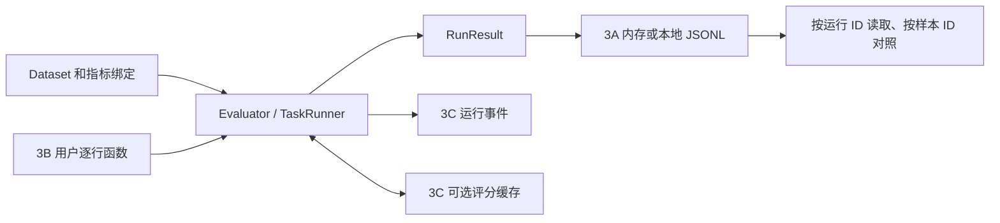

# 阶段 3 · 运行与持久化

阶段 3 代码已在本地提交 `cb8ad6d`。基于阶段 2 的 `28a24de`，`Evaluator` 和 `@experiment` 共用调度器，`RunResult` 可保存、按 ID 重读并逐行对照。新运行写 schema v2，读取器支持阶段 1、2 的 v1。[现有运行结果](../tallyjudge/core/results.py) · [阶段 2 验收](phase-2.zh-CN.md#本轮验收记录)

路线图中的**阶段 2b** 继续承担单轮 RAG 的五项检索指标和两项参考答案指标。下一个 RAG 版本仍先做检索质量。阶段 3 按下面三个批次实施，各批次可用现有文本指标及两个 RAG 指标独立验收。[迭代路线](roadmap.zh-CN.md#单轮-rag-的三个功能版本)

## 交付顺序

| 批次 | 调用者能做的事 | 完成条件 |
|---|---|---|
| **3A · 保存、读取、对照** | 显式保存一次运行，在新进程按 `run_id` 读取，再按 `case_id` 查输入、状态和用量。用相同绑定逐行对照两次运行。 | 两个存储后端通过同一份契约测试。首批交付到此即可单独使用。 |
| **3B · 运行自己的实验** | 用 `@experiment` 对每行生成业务输出，再接现有指标或无模型的函数指标。 | 单一执行器控制行函数和指标，空返回、错误、超时和取消均可在保存后的结果中找到。 |
| **3C · 解释请求并复用得分** | 查一次评分实际发了哪些请求，可选择复用已完成的分数，也可用命令行运行本地指标、读取结果。 | 冷缓存、命中、结构化重问与取消时的请求数均可解释，同一批输入的 Python 与 CLI 评分一致。 |



## 3A · 先把一次运行读回来

现有快照已经保存 `case_id`、`input_index`、样本内容的 SHA-256、绑定 key、插件 ID、评分 revision 和配置。读取这些记录即可解释旧结果，读取过程无需创建模型或加载当时的指标插件。[Dataset](../tallyjudge/core/dataset.py) · [执行器生成的运行元数据](../tallyjudge/core/execution.py)

以下是保存和读回的公开接口，`dataset` 是已构造的 `Dataset`。现有的评测调用方式继续适用。

```python
from tallyjudge import Evaluator, create_metric, create_storage_backend

def save_evaluation(dataset, root):
    result = Evaluator([create_metric("metric.text.exact_match")]).run(dataset)
    store = create_storage_backend("storage.local.jsonl", root=root)
    result.save(backend=store, include_inputs=True)
    return result.run_id


def review_case(root, run_id, case_id):
    store = create_storage_backend("storage.local.jsonl", root=root)
    restored = store.load_run(run_id)
    return restored.input_for(case_id), restored.row_for(case_id).metrics
```

- **结果契约**。先实现 `RunResult.from_dict`，作为恢复嵌套行、错误、清理警告及用量的统一入口。读入阶段 1、2 的 schema v1，旧记录缺少的 `usage` 或错误 `code` 表示当时未记录。汇总沿用现有聚合函数从行重算。`row_for` 和 `input_for` 按 manifest 中同一组 ID 和序号定位，保留原始字典和自定义 ID 字段。空数据集的输入是 `[]`。脱敏导出省略 `inputs` 时，读取模型以 `None` 表示原文不可用，可查行结果，`input_for` 明确报告原文未保存。[汇总](../tallyjudge/core/aggregation.py)
- **存储契约**。`StorageBackend` 先提供 `save_run(result, *, include_inputs)` 和 `load_run(run_id)`。`RunResult.save` 委托给显式传入的后端。`storage.local.memory` 为调用者保存独立副本，`storage.local.jsonl` 在指定目录为每个运行写一个文件。首行存版本、运行状态、配置、绑定、行数、清理警告和输入保留方式，随后每行存一条 manifest 记录、对应行结果及可选原始输入。只持久化已结束的运行，覆盖 `completed`、`stopped`、`aborted` 和 `cancelled`。保存失败单独报告，调用者仍可使用手中的结果。
- **写入与恢复**。JSONL 后端负责路径约束和同目录临时文件的原子发布。同 ID、同内容的重试幂等，同 ID 内容冲突报告给调用者。并发写入也遵守这条约定，原文件在序列化失败时保持可读。读取遇到截断、重复样本 ID 或未知版本时报告文件及原因。旧后端的原子写入可供迁移，旧读取器略过坏行的做法会改变覆盖率。[旧 JSONL 后端](../src/ragas/backends/local_jsonl.py) · [旧内存后端](../src/ragas/backends/inmemory.py)
- **逐行对照**。使用纯函数 `compare_runs(left, right)`。先按显式 `case_id` 对齐，再按绑定 key 匹配，展示两侧状态、值和原因。单侧缺行、样本摘要变化、插件 ID／revision、字段映射或配置变化分别标出。仅在输入和评分口径一致且两侧数值均成功时给出分差。自动生成的 `row-N` 只有在有序 manifest 完全相同时才能用于对齐，并提示按位置生成的 ID。比较过程不触发评测。
- **验收样本**。三行样本分别完全匹配、不匹配、输入类型错误。保存再读回，应得到 `success, success, error`，均值 `0.5`，覆盖率 `2/3`。交换显式 ID 的行序后仍能对齐。另测零行、隐藏原始输入、已有部分 token 的取消快照、同 ID 并发写入，以及损坏文件。测试用 `tmp_path` 生成运行文件。

`RunResult.from_dict`、两个存储后端和 `compare_runs` 可独立使用。两次评测即使使用不同的存储方式，也能直接比较读回的结果。[存储与对照测试](../tests/tallyjudge/contracts/test_run_storage.py)

## 3B · 实验函数和函数指标

旧 `ExperimentWrapper.arun` 一次为全部样本创建协程，按完成顺序追加结果，异常和返回 `None` 的行会消失。保留易用的逐行函数入口，把调度交给已有 `TaskRunner`。[旧实验入口](../src/ragas/experiment.py) · [当前调度器](../tallyjudge/core/execution.py)

`@experiment` 可装饰普通短函数或异步函数，调用形态为 `await experiment_fn.arun(dataset, metrics=[...], config=..., collector=...)`。同一行先执行一次用户函数，成功后再调度这行的指标。行任务与指标任务共用并发预算、超时、清理宽限和停止策略。开始计时的单位是已调度的一次行任务或指标任务。

| 行函数结局 | 行记录与下游行为 |
|---|---|
| 返回 JSON 字典 | 单独记录业务输出。评分视图将输出覆盖到同名输入列，原始输入、身份和摘要保持可查。指标按原有 `input_map` 取值。 |
| 返回 `None` | 行任务记为 `skipped`，依赖该输出的指标保留 `not_started`。 |
| 抛错、超时、外部取消 | 行任务保留相应状态及诊断，各绑定保留实际已达到的状态。`record` 可继续其他行，`raise` 延用部分结果异常，外部取消原样传播。 |

在 `RowResult` 增加可选的行任务结果，保存状态、业务输出、错误和该步骤自己的已观测用量。调用者可显式保存正常结果、`EvaluationAborted.partial_result` 或取消后的 collector 快照。自动保存通过同一后端，默认关闭。正常完成后若自动保存失败，通过存储异常携带本次结果。已有运行异常或外部取消时优先传播原异常，存储故障另记本地日志，结果仍可从部分结果或 collector 取回。业务输出和指标 reason 由用户函数产生，`include_inputs=False` 仍只控制原始输入。

无模型的函数指标共用 `MetricSpec` 和绑定输入校验。装饰器按带类型注解的函数构造指标工厂，显式声明插件 ID 和评分 revision，直接构造实例或通过现有注册表登记。模块导入不产生全局评分实例。

| 公开装饰器 | 输出约定与汇总 |
|---|---|
| `numeric_metric` | 延用有限 float、值域、均值和覆盖率。 |
| `categorical_metric` | 接受声明集合中的字符串，提供标签计数、有效数和覆盖率。对应旧 `discrete_metric`。 |
| `ranking_metric` | 保留有序 JSON 列表和声明的长度约束，提供有效数和覆盖率。排序与类别的数值均值均为空。 |

阶段 3 扩展了 `MetricResult`、`ScoreResult`、输出校验、汇总与存储。每个绑定在快照中声明输出种类，读取旧运行时按 v1 的数值约定恢复。随行任务状态和新值类型启用结果 schema v2，v2 在绑定元数据中记录输出种类，读取继续支持 v1 数值结果。无效输出沿用 `invalid_output`。[指标契约](../tallyjudge/interfaces/metrics.py) · [函数指标装饰器](../tallyjudge/api/metrics.py) · [旧装饰器](../src/ragas/metrics/decorator.py) · [旧输出校验](../src/ragas/metrics/validators.py)

**验收**。构造成功、返回空、异常和慢任务混合的数据集，以单个并发上限运行。核对行序、上限、尚未调度的绑定和取消后的快照。数值、类别和排序结果在同一次运行中分别保存、读回及汇总。

## 3C · 请求事件、评分缓存和最小 CLI

**请求与用量。** 生命周期事件由调度器产生，请求事件由现有 `record_request` 产生。事件关联 `run_id`、`case_id`、绑定 key 或行任务。`agenerate` 或 `aembed_texts` 为逻辑调用分配 `call_id`，已有的请求记录边界为每次实际发送分配 `attempt_id`。开启事件时，模型调用结果可用 `call_id` 找到相关明细。结构化重问按次记录，嵌入分批可按批次区分。调用者可注入 `EventSink`，本地 JSONL 事件记录按运行归档。事件只携带状态、标识和已观测用量。可选观察器写入失败时报告该运行的记录不完整，评分与原有取消语义继续由执行器决定。行结果封存后，迟到响应不能改写终态。`RunResult.usage` 直接合并行任务及各绑定的已封存记录，每份只计一次，保留 `known_counts`、未知 token、在途请求和 `untracked_sources`。[请求记录](../tallyjudge/core/usage.py) · [内置传输层](../tallyjudge/plugins/_openai_compatible.py)

**缓存。** 首版缓存粒度选为一次完整且成功的绑定评分，默认关闭。这样 `AnswerRelevance` 冷运行时仍会按 `strictness` 独立生成多个问题。键使用调用者选定的缓存命名空间、样本 ID、绑定 key、列映射和输入校验后的具名参数内容、插件 ID、revision 与完整配置快照，包含模型部署标签及提示词版本。部署或自定义实现有未反映在快照的变化时，由调用者更换命名空间。缓存载荷保留有效值与 reason。命中沿用 `success`，v2 得分记录 `cache_hit=True`，启用事件时发出命中事件。本次没有发送模型请求，沿用 `ScoreResult.usage=None` 的语义。缓存键在发送请求前生成，写入发生在调度器接受成功终态后。磁盘插件首选标准库 SQLite 按键原子写入，并发未命中时逐项记录真正发生的请求。[旧缓存](../src/ragas/cache.py)

**命令行。** 先用标准库提供 `tallyjudge metrics list`、`tallyjudge run --input samples.jsonl --metric metric.text.exact_match --store runs` 和 `tallyjudge runs show RUN_ID --store runs`。首版命令行运行可从静态配置独立构造的本地指标，需要注入客户端的评分沿用 Python 入口。命令复用注册表、`Evaluator` 与存储，输出运行 ID、状态及结构化结果。约定退出码 0 对应 `completed`（含 record 模式的行错误），1 对应停止、中止或读写失败，2 对应命令参数错误，用户在终端中断时返回 130。

**验收**。冷运行、命中、切换模型配置、重问一次、第二批嵌入失败和中途取消分别核对实际请求数与事件。命中后的运行用量不得重复累计先前 token。在仓库外安装 wheel，比较 CLI 与 Python 的样本顺序、绑定状态、得分和覆盖率，运行 ID 可独立生成。

## 使用约定

- `Evaluator(..., backend=store, include_inputs=False)` 和 `experiment_fn.arun(..., backend=store, include_inputs=False)` 在结束时自动保存。省略 `backend` 时，可在运行后用 `result.save(backend=store)` 显式保存。自动保存失败可从 `RunSaveError.result` 取回结果。
- `@numeric_metric("metric.team.score", revision="1")` 声明工厂，调用 `score()` 创建指标，再传给 `Evaluator` 或实验。类别指标通过 `labels` 指定可用标签，排序指标通过 `length` 指定列表长度。同步行函数适合短计算；等待 I/O 的行函数使用 `async def`，以便在等待期间让出并发名额并响应取消。
- 用 `create_event_sink("event.local.jsonl", root=...)` 构造事件写入器，传入 `event_sink=`。按 run ID 分文件保存，`metric_key` 为空标识行任务。每次实际请求有独立的 `attempt_id`，同一逻辑调用的重问或嵌入批次共享 `call_id`。在途请求以开始事件和封存用量为准。观察器出错会记日志，并将 `result.events_complete` 设为 `False`。
- 用 `create_cache_backend("cache.local.sqlite", path=..., namespace="部署版本")` 构造评分缓存，传入 `cache=`。缓存读写失败记入本地日志，本次评分仍可完成。命中只复用值与 reason。替换部署、修改自定义算法时，用新的命名空间或 revision 区分结果。
- JSONL 存储在同一目录写完临时文件后原子发布。目录所在文件系统需要支持硬链接。测试用运行文件在临时目录生成。

## 本地验收

在 Windows / Python 3.12.7 上，从阶段 1 的 `50ccb2d` 和阶段 2 的 `28a24de` 各自运行同一份三行样本，再用当前读取器打开两份 v1 输出。两次都恢复出 `success, success, error`，均值为 0.5，覆盖率为 2/3。

内存与 JSONL 后端共用存储契约测试，包含跨读写实例、竞争写入、文件损坏和脱敏读回。实验用例验证共用并发预算、部分结果、取消和三种输出。模型离线测试检查结构化重问、嵌入分批失败、冷运行与缓存命中的请求数。最小依赖 wheel 已在仓库外安装，三个命令均从已安装的入口运行，其逐行结果和汇总与 Python 一致。[实验测试](../tests/tallyjudge/unit/test_experiments.py) · [事件与缓存测试](../tests/tallyjudge/integration/test_run_observability.py) · [安装测试](../tests/tallyjudge/installation/wheel_probe.py)

## 实现落点与阶段边界

| 批次 | 复用或扩展 | 新增位置 |
|---|---|---|
| 3A | `core/results.py`、`core/aggregation.py`、注册表与公开工厂 | `interfaces/storage.py`、`plugins/storage/`、用于逐行对照的 `api/comparison.py` |
| 3B | `core/execution.py`、结果模型、`interfaces/metrics.py` | `api/experiment.py`、`plugins/metrics/custom/` 中的函数指标 |
| 3C | `core/usage.py`、模型请求边界、调度器和已有 JSONL 读写 | `core/events.py`、`interfaces/events.py`、`interfaces/cache.py`、本地事件与缓存插件、`cli.py` |

存储、缓存与事件插件沿用同一注册表和静态清单。本地 JSONL、CLI 和磁盘缓存分别使用标准库的文件读写、`argparse` 和 `sqlite3`，默认 Python 包延用现有 Pydantic 依赖。跨次逐行对照属于 3A，统计显著性、金额核算和远端存储留给后续需求。模型判分型自定义指标归阶段 4，厂商追踪与 LangChain／LangGraph 接入归扩展阶段。独立 Streamlit 界面将使用这里的 Python 读取与查询接口。[架构总设计](plugin-architecture.zh-CN.md) · [迭代路线](roadmap.zh-CN.md)

## 提交复核

对 `cb8ad6d` 的独立源码快照运行新包测试，212 项通过，含 NumPy 和可选模型 SDK 用例。在工作区按项目配置运行 Ruff 检查、格式检查和 Pyright，均通过。以下五项经公开 Python 入口另行复现，仍待修正。

| 优先级 | 已观察到的行为 | 建议修正的位置和验收条件 |
|---|---|---|
| P1 · 缓存阻塞取消 | SQLite 的另一个连接持有约 250 ms 写锁。一次精确匹配外套 50 ms `asyncio.timeout`，约 269 ms 后仍返回 `completed`。同一事件循环上的 20 ms 定时器也延至约 269 ms。 | 将阻塞式缓存 I/O 移出事件循环。保留调度器接受成功结果后才允许写缓存的顺序。以正常运行、写锁竞争及外层取消分别验证终态和定时器。[缓存读写调用处](../tallyjudge/core/jobs.py) |
| P2 · 评分配置误判相同 | 配置由 `{"mode":true}` 改成 `{"mode":1}`，同 ID、同 revision 的合法判分函数得到不同分数。`compare_runs` 没标出口径变化，直接给出 `delta=1.0`。 | 配置比较复用缓存已有的规范化 JSON 表示。上述样本应标 `config_snapshot` 且 `delta=None`。[绑定比较](../tallyjudge/api/comparison.py) |
| P2 · 脱敏后失去可比性 | 对同一样本做普通评测与原样返回 `response` 的实验。保留输入时差值是 `0.0`，两端均省略原文后读回却报告 `experiment_input_changed`。 | 新存档可在执行边界记录实际绑定输入的摘要。旧存档证据不足时应表达无法确认。分别验收原样覆盖、确实改值和两种留存策略。[实验列比较](../tallyjudge/api/comparison.py) |
| P2 · 存档接受违约结果 | 在一份 JSONL 中把合法分类改成未声明的 `"unknown"`，把固定长度 2 的排序改成 `[]`。读回仍把两者计为有效，分类覆盖率为 `1.0`。 | 在读入边界按已保存的标签和长度复用输出契约，报出有问题的行及绑定。保持 v1 数值读回和合法 v2 文件原有行为。[存档读取](../tallyjudge/core/results.py) |
| P2 · 函数默认参数在批量入口丢失 | 函数 `score(response: str, scale: float = 2.0)` 直接 `ascore(response="cat")` 得 `6.0`，同一实例交给 `Evaluator` 却报缺少 `scale`。 | 装饰器保留默认值，由绑定统一解析实际评分参数并用于缓存。验收省略、显式给默认值及覆盖三种调用，指标体只负责计分。[函数装饰器](../tallyjudge/api/metrics.py) |

运行调度与扩展的职责划分符合总设计。实验行函数和评分共用 `TaskRunner`，新后端经静态注册表接入，CLI 调用公开 Python 接口。上述修正各有一个负责边界，无需另建调度器或框架兼容层。[编码总纲](implementation-standards.zh-CN.md#评审与验证) · [阶段 4 设计](phase-4.zh-CN.md)
