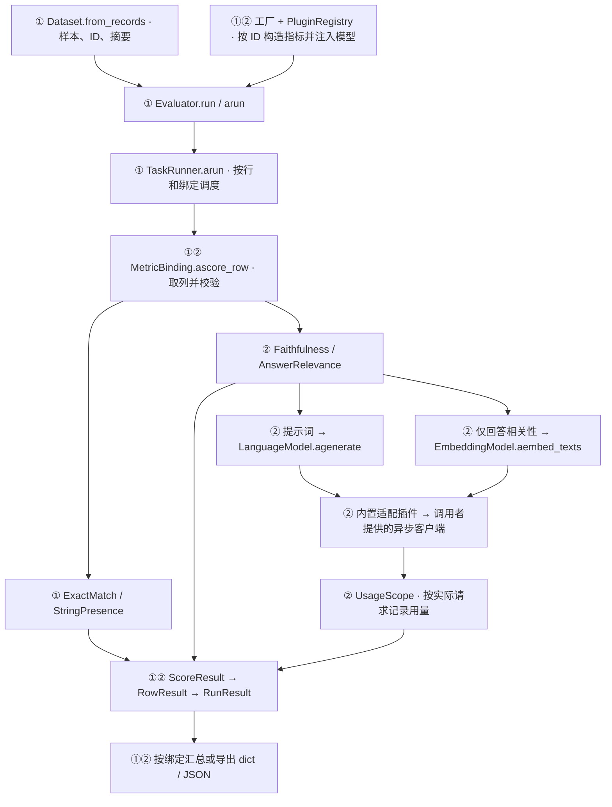
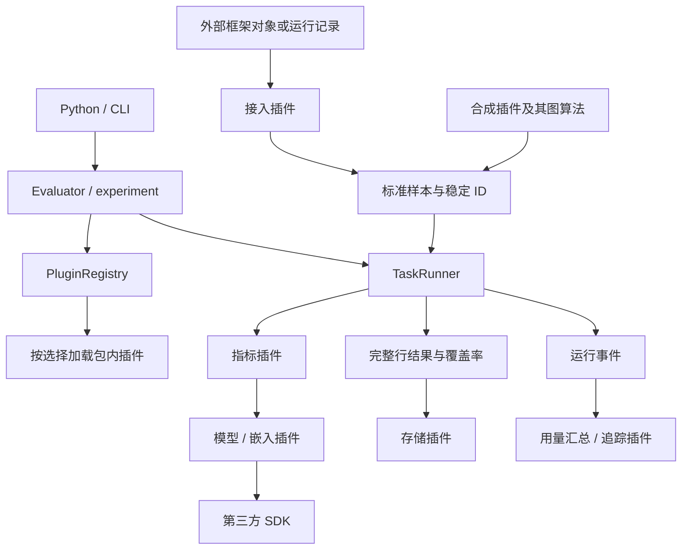

# TallyJudge 迁移与包内插件架构设计

更新于 2026-11-19。原实现对照基线为 `ec00339`。本文描述整体目标，各阶段文档记录已经实现和验收的接口。

[项目介绍](../README.md) · [架构与编码总纲](implementation-standards.zh-CN.md) · [迭代路线](roadmap.zh-CN.md) · [第一阶段设计](phase-1.zh-CN.md) · [两阶段已实现的调用链](#阶段-1-和-2-已实现的调用链) · [阶段 3 设计](phase-3.zh-CN.md) · [阶段 4 设计](phase-4.zh-CN.md)

## 决策与当前状态

| 项目 | 已确认决策 / 当前状态 |
|---|---|
| 项目与环境 | TallyJudge；新包 tallyjudge；最低 Python 3.12 |
| 开发位置 | 仓库根目录 tallyjudge/；src/ragas、旧示例和旧测试保留原位供对照 |
| 本地安装 | 根 pyproject 已安装新包；原 examples 不属于新工作区 |
| 当前实现 | 两个本地文本指标和首批两个 RAG 指标均可从 `Evaluator` 运行。阶段 3 复用同一调度器运行实验与函数指标，结果可按 ID 保存、读回及对照。请求事件、SQLite 评分缓存和本地 CLI 已实现。 |
| 架构 | 稳定内核 + 同包发布的插件；外部框架仅在插件侧接入 |
| 命名 | 指标类统一 Metric 后缀；插件 ID 稳定且与类名分离 |
| 依赖 | 默认轻量；第三方 SDK 随插件实现按需加入；单包发布不等于全 SDK 必装 |
| 旧实现 | 选择性复制算法并重构；不建设旧 API 兼容层，不删除原目录 |
| 远期 | 可视化暂不排期；完整工作流过程评测仍需后续设计 |

能力与来源表记录上游实现，接口和目录树描述新包的目标，路线文档给出迁移顺序。已有运行证据的部分见[本地评测](phase-1.zh-CN.md)及[单轮 RAG 回答质量](phase-2.zh-CN.md#本轮验收记录)。


## 阶段 1 和 2 已实现的调用链

业务系统把已有回答和检索上下文交给 TallyJudge。阶段 1 建成从样本到结果的评测内核，阶段 2 在同一条批量执行路径上接入模型，完成单轮 RAG 的回答质量评测。四个指标共用样本标识、字段绑定、调度和结果格式。



| 设计中的环节 | 当前实现 | 从哪里读 |
|---|---|---|
| 数据准备 | ① 从字典记录建立样本。使用调用者提供的 ID 或按行号生成 ID，保存输入顺序和内容摘要。 | [Dataset](../tallyjudge/core/dataset.py) |
| 配置与装配 | ① 按插件 ID 创建指标。`MetricBinding` 把参数名映射到数据列，同一指标可用不同 key 重复绑定。② 新增生成和嵌入工厂，异步客户端与可序列化配置分别传入。 | [公开工厂](../tallyjudge/api/factories.py) · [注册表](../tallyjudge/registry/registry.py) |
| 运行一次评测 | ① `Evaluator.run` 和 `arun` 共用 `TaskRunner.arun`，以“行 × 指标绑定”为调度单位，控制并发、超时、取消和清理。通过绑定取得符合 `MetricSpec` 的输入。模型插件在调用者的事件循环中运行。 | [Evaluator](../tallyjudge/api/evaluator.py) · [执行器](../tallyjudge/core/execution.py) · [指标与绑定](../tallyjudge/interfaces/metrics.py) |
| 指标计算 | ① 文本精确匹配、参考文本包含。② 忠实度先拆陈述再判断上下文是否支持。回答相关性从回答反推问题，再用嵌入与原问题比较。两个模型指标通过协议调用模型。 | [文本指标](../tallyjudge/plugins/metrics/text) · [RAG 指标](../tallyjudge/plugins/metrics/rag) · [模型协议](../tallyjudge/interfaces/models.py) |
| 结果与诊断 | ① 每个绑定在每行都有结果，可按绑定查看均值、覆盖率和状态计数，也可从 `RunCollector` 取部分快照。② 增加算法无定义的原因码和用量。按实际请求计数，保留已知 token，行进入终态时封存。 | [结果与快照](../tallyjudge/core/results.py) · [汇总](../tallyjudge/core/aggregation.py) · [请求用量](../tallyjudge/core/usage.py) |

### 已实现的文件树

① 为阶段 1 建立，② 为阶段 2 新增，①② 表示阶段 2 扩展了原文件。下图列出有运行或验证职责的文件，省略常规子包初始化文件。

```text
tallyjudge/
├── __init__.py                         ①② 公开导出
├── api/
│   ├── evaluator.py                    ①  run / arun
│   └── factories.py                    ①② 指标、生成模型和嵌入模型工厂
├── core/
│   ├── dataset.py, config.py           ①  标准样本、执行配置
│   ├── execution.py, errors.py         ①② 调度与异常分类
│   ├── results.py, aggregation.py      ①② 行结果、运行结果、汇总
│   └── prompts.py, usage.py            ②  提示词渲染、请求用量
├── interfaces/
│   ├── metrics.py                      ①② 指标契约、绑定和输入校验
│   └── models.py                       ②  两种模型协议、结构化生成
├── registry/
│   └── specs.py, registry.py, builtins.py   ①② 描述、构造与内置插件登记
├── plugins/
│   ├── metrics/text/
│   │   └── exact_match.py, string_presence.py         ①
│   ├── metrics/rag/
│   │   └── faithfulness.py, answer_relevance.py       ②
│   ├── _openai_compatible.py                          ②  共用客户端视图与请求记录
│   ├── models/openai_compatible.py                    ②  Chat Completions
│   └── embeddings/openai_compatible.py                ②  文本嵌入
└── py.typed                            ①  分发包类型标记

tests/tallyjudge/
├── unit/, contracts/                   ①② 算法、执行行为与插件契约
├── migration/                          ①② 34 组文本行为和 13 组 RAG 用例
├── installation/                       ①② 从仓库外验证 wheel
└── integration/                        ②  真实 SDK 与本地模拟 HTTP
tools/migration/                        ①② 需要复核上游时在独立旧环境运行
src/ragas/                                 原实现，供源码和行为对照
```

阶段 2 结束时内置登记有四个指标和两个模型适配插件。默认运行依赖只有 Pydantic。用户可以向 RAG 指标注入满足协议的自定义模型，或向内置适配插件注入 OpenAI 兼容异步客户端。用量统计位于请求边界，SDK 的生命周期由调用者管理。

### 与后续设计的分界

单轮 RAG 的九个目标指标中，首版交付忠实度和回答相关性。下一版是检索质量的五项指标，包括有参考与无参考的上下文精度、上下文召回、文档 ID 精度与召回。第三版交付参考答案语义相似度和答案正确性。两项本地字符串指标单独计入阶段 1。[单轮 RAG 的三个版本](roadmap.zh-CN.md#单轮-rag-的三个功能版本)

阶段 3 在这条链路上增加 `RunResult.save`、`StorageBackend.load_run` 和 `compare_runs`。实验函数先生成业务输出，随后进入同一套指标绑定和调度。事件与缓存由调用者选择，CLI 直接调用 Python 入口。[阶段 3 实现](phase-3.zh-CN.md#使用约定)LangChain、LangGraph 等接入留在插件侧，Prompt／工作流／Agent 评测继续沿扩展路线推进。可视化计划在独立仓库使用 Streamlit 调用同一套 Python 入口。[迭代路线](roadmap.zh-CN.md)

## 设计约束与标记

- 优先保持已有 RAG 评测能力、输入数据含义和可解释的评分行为，不承诺保留旧 API。
- 采用包内插件：插件源码、注册描述和测试与主包一起维护发布，不要求用户管理独立插件包。
- 内核只负责数据契约、执行、结果与事件，不导入 LangChain、LangGraph、OpenAI、Instructor、HF datasets、Pillow 或图算法库。
- 外部框架适配属于插件；不设置 legacy/compat 大目录来长期容纳旧评估系统。
- 图合成是已有的扩展能力，不是评测内核。保留其必要算法，迁移完成后删除旧生成管线；不把“图算法”误称为 LangGraph。
- 可视化不进入当前实现范围；本轮只预留可序列化配置与结果。旧源码原地保留，新代码独立建设，不通过 import ragas 转发实现。

标记：**保留**＝职责与名称基本不变；**迁移**＝搬位置并调整依赖；**改名**＝公共符号发生变化；**重构**＝契约或行为变化，不能直接替换 import；**新增**＝当前没有对应完整实现；**删除**＝从新包设计和发布面排除旧实现；当前不删除 src/ragas 原文件。

对照表中，已验收条目标出 TallyJudge 实现名及验证范围。其他条目的状态以各阶段的运行记录为准。

## 当前源码与调用链

| 链路 | 当前入口与代码 | 当前问题 |
|---|---|---|
| 包初始化 | [__init__.py](../src/ragas/__init__.py) → evaluation、dataset_schema、tokenizers | 提前导入重模块；导入子模块也会先执行父包入口 |
| 旧批量评估 | [evaluation.py](../src/ragas/evaluation.py) evaluate/aevaluate → [executor.py](../src/ragas/executor.py) → 旧 Metric → EvaluationResult | LangChain 数据类型、回调和旧指标协议贯穿全过程 |
| 新实验 | [experiment.py](../src/ragas/experiment.py) experiment → ExperimentWrapper.arun → 用户函数 → Experiment.save | 无并发上限；失败行与 None 结果丢失；按完成顺序保存 |
| 新指标 | [collections/base.py](../src/ragas/metrics/collections/base.py) → SimpleBaseMetric、InstructorBaseRagasLLM、BaseRagasEmbedding | 三个共享基类所在模块都牵连旧实现；具体类型检查限制插件替换 |
| 模型 | [llms/base.py](../src/ragas/llms/base.py)、[adapters](../src/ragas/llms/adapters/base.py) | 现代协议、Instructor 实现、旧 LangChain wrappers 混居 |
| 嵌入 | [embeddings/base.py](../src/ragas/embeddings/base.py)、各 provider | 现代 ABC 已存在，但所在模块顶层导入 LangChain 与 OpenAI 适配 |
| 生成 | [testset/synthesizers/generate.py](../src/ragas/testset/synthesizers/generate.py) → transforms → 图、persona、场景 → Testset | 依赖旧 Prompt、回调、模型包装和调度 |
| 存储 | [dataset.py](../src/ragas/dataset.py) DataTable → [backends/base.py](../src/ragas/backends/base.py) | 后端协议已有；Dataset/Experiment 与通用数据、运行结果需要重新划界 |

## 能力对照表

### 指标能力

下表的新实现均位于 [metrics/collections](../src/ragas/metrics/collections/__init__.py)，除明确注明者外。目标指标实现放入 tallyjudge/plugins/metrics；所有目标指标按“全局命名规范”统一命名，表内旧/新实现列只表示当前源码名称。

| 能力 | 旧实现/符号 | 已有新实现 | 处理与缺口 |
|---|---|---|---|
| 忠实度 | _faithfulness.Faithfulness | faithfulness.Faithfulness | 已迁移为 `FaithfulnessMetric`。保留二元判定和按返回判定数取分母的公式，空陈述与空判定各有原因码。 |
| 本地 HHEM 判分 | FaithfulnesswithHHEM | 未发现对应 collections 实现 | 重构为可选判分插件；不能用普通 LLM Faithfulness 冒充等价替代 |
| 回答相关性 | _answer_relevance.AnswerRelevancy/ResponseRelevancy | answer_relevancy.AnswerRelevancy | 已迁移为 `AnswerRelevanceMetric`。已对照反推问题、回避标记和带符号余弦，零向量记为无定义。 |
| 答案正确性 | _answer_correctness.AnswerCorrectness | answer_correctness.AnswerCorrectness | 迁移；保留单侧空声明修复；核验事实性与相似度权重 |
| 语义相似度 | _answer_similarity.AnswerSimilarity/SemanticSimilarity | _semantic_similarity.SemanticSimilarity | 迁移；保留异步和零阈值修复；AnswerSimilarity 旧别名删除 |
| LLM 上下文精度 | LLMContextPrecisionWithReference/WithoutReference、ContextPrecision、ContextUtilization | ContextPrecisionWithReference/WithoutReference、ContextPrecision、ContextUtilization | 采用明确的 with/without reference 配置；先核验 AP、空列表和参考字段，再收敛别名 |
| LLM 上下文召回 | LLMContextRecall、ContextRecall | context_recall.ContextRecall | 迁移新版；核验声明分类与分母 |
| ID 检索指标 | IDBasedContextPrecision/Recall | 未发现对应 collections 实现 | 迁移算法为两个无模型指标插件；保留 ID 字段，覆盖重复 ID、空输入和排序 |
| 非 LLM 上下文匹配 | NonLLMContextPrecisionWithReference、NonLLMContextRecall | 未发现同等 collections 实现 | 迁移算法为插件；保留阈值与空上下文修复；与 ID 匹配分开 |
| 实体召回 | ContextEntityRecall | context_entity_recall.ContextEntityRecall | 迁移；核验实体提取、去重及空实体 |
| 事实正确性、噪声敏感度 | FactualCorrectness、NoiseSensitivity | factual_correctness、noise_sensitivity | 迁移；核验 recall/Fβ 与噪声分类，保留已有修复 |
| 答案准确度、上下文相关度、回答依据 | _nv_metrics 中三个指标 | answer_accuracy、context_relevance、response_groundedness | 迁移；具体 judge 模型为配置，不写死在内核 |
| 摘要 | SummarizationScore | summary_score.SummaryScore | 采用新版名称；对照长度惩罚、空 QA、结果字段，不视为单纯改名 |
| 字符串 | ExactMatch、StringPresence、NonLLMStringSimilarity | _string 中同名实现 | 优先迁移；ExactMatch/StringPresence 作为最小安装验收；相似度算法依赖按插件需求加载 |
| 文本统计 | BleuScore、RougeScore、ChrfScore | BleuScore、RougeScore、CHRFScore | 迁移；ChrfScore 改名 CHRFScore；核验空参考和全文计分，新旧行为不完全一致 |
| SQL 与表格 | LLMSQLEquivalence、DataCompyScore | SQLSemanticEquivalence、DataCompyScore | 前者名称变化；后者列模式缺行满分问题尚待 #3094，不能宣称已解决 |
| rubric 评分 | RubricsScore、InstanceRubrics | domain_specific_rubrics、instance_specific_rubrics | 迁移；对照 rubric 来源、范围和多轮输入 |
| 自定义二值判定 | AspectCritic | DiscreteMetric 可表达类别，但不是等价替代 | 补齐 strictness/多数投票、单轮/多轮模板与二值结果映射，再删除旧类 |
| 自定义数值判定 | SimpleCriteriaScore | NumericMetric 可表达分数，但不是等价替代 | 明确整数/连续值、范围、多轮输入和提示词迁移 |
| 自定义函数、分类、排序 | metrics/decorator.py、numeric.py、discrete.py、ranking.py | 已存在现代实现 | 迁移并统一注册；保留函数型与模型判分型两类，不强制自定义规则指标调用 LLM |
| Agent 工具调用 | ToolCallAccuracy、ToolCallF1 | tool_call_accuracy、tool_call_f1 | 迁移；工具序列长度不一致的部分得分变化另审 #3080 |
| Agent 目标、话题 | AgentGoalAccuracyWith/WithoutReference、TopicAdherenceScore | agent_goal_accuracy、TopicAdherence | 迁移；话题指标名称变化；不等于完整过程/安全评测 |
| 多模态 | MultiModalFaithfulness、MultiModalRelevance | 两个同名 collections 实现 | 迁移到多模态指标插件；Pillow、图片读取策略留在插件，保留 SSRF 修复 |
| 引用片段 | metrics/quoted_spans.py | collections/quoted_spans.QuotedSpansAlignment | 核对两套具体接口后收敛到新插件，保留引用抽取能力 |

源证据：[旧导出及别名](../src/ragas/metrics/__init__.py)、[新导出](../src/ragas/metrics/collections/__init__.py)、[旧精度](../src/ragas/metrics/_context_precision.py)、[旧召回](../src/ragas/metrics/_context_recall.py)、[旧 HHEM](../src/ragas/metrics/_faithfulness.py)、[AspectCritic](../src/ragas/metrics/_aspect_critic.py)、[SimpleCriteria](../src/ragas/metrics/_simple_criteria.py)。

### 非指标能力

| 能力 | 已有实现 | 目标与状态 |
|---|---|---|
| 样本/消息/工具调用 | SingleTurnSample、MultiTurnSample、messages.py | 迁移到 core；保留字段名，不引入外部框架消息对象 |
| 数据表、读写 | DataTable、Dataset、CSV/JSONL/内存/GDrive | 数据模型迁移；后端变为包内存储插件；保留原子保存和名称校验 |
| 批量评估 | 旧 evaluate + Executor | 新增 Evaluator 门面，重构共用执行器；旧函数和旧 Metric 调用链删除 |
| 实验函数 | @experiment、ExperimentWrapper | 保留使用习惯，重构为同一执行器；保留完整行状态 |
| 同步/异步、取消、并发 | async_utils、Executor、RunConfig | 抽取可用算法；废除 nest_asyncio 依赖，运行中的事件循环要求 await |
| 模型/嵌入 | Instructor、LiteLLM、OpenAI、Google、HF、框架 wrappers | 独立协议 + 包内实现插件；禁止内核通过 isinstance 判断具体供应商 |
| Prompt | simple_prompt、prompt/metrics、旧 PydanticPrompt | 迁移渲染、示例、序列化等能力；请求/解析归模型插件；旧 LangChain Prompt 体系删除 |
| 缓存 | CacheInterface、DiskCacheBackend、cacher | 协议迁移，磁盘实现插件化；缓存命中不报告虚构的模型 token 消耗 |
| 费用/追踪 | cost、callbacks、外部 tracing integrations | 新增供应商无关 Usage/RunEvent；重构成本汇总与追踪插件 |
| 合成测试集 | 图、transforms、persona、单跳/多跳、预切片、Testset | 作为 synthesis 插件迁移；不进入评测核心；旧入口删除前验证四类生成路径 |
| Prompt 优化 | genetic、DSPy、标注与 losses | 迁移到 optimization 扩展，首批不重写算法；不是已完成的 Prompt 对比产品 |
| 框架接入 | integrations 下 LangChain、LangGraph、AG-UI、LlamaIndex 等 | 拆成标准样本转换、模型接入、追踪三种责任；不能整目录搬进内核 |
| Git 实验版本 | version_experiment | 可选版本记录插件；保留 worktree 修复，不要求基本评测安装 GitPython |
| 云端 SDK/遥测 | sdk.py、_analytics.py | 审核调用点后迁出内核或删除；默认不发送上游平台遥测 |
| Prompt 评测 | 自定义指标、实验与优化器提供基础 | 已有基础能力；版本化提示词比较、预算与数据集协议仍需补齐 |
| 工作流/Agent 评测 | 实验函数、多轮指标和接入转换 | 部分已有；统一步骤 trace、分支覆盖、过程指标为后续新增 |
| 可视化 | 不作为现有完整能力 | 远期方向，不创建 UI 工程、不排当前里程碑 |

## 全局命名规范

旧名称只用于定位来源；新包统一采用以下目标名称，不导出旧别名。改名不是计算公式变更，也不表示相关能力已经实现。

| 对象 | 规则 | 示例 |
|---|---|---|
| Python 包、模块、目录 | 小写 snake_case；包根固定 tallyjudge | tallyjudge/plugins/metrics/rag/faithfulness.py |
| 类与协议 | PascalCase，指标类统一以 Metric 结尾；协议不加 Base/I 前缀 | FaithfulnessMetric、LanguageModel、StorageBackend |
| 函数、参数、属性 | snake_case，操作用动词，构造用 create_ | create_language_model、create_embedding_model、case_id |
| 同步/异步接口 | 同步原名，异步统一前缀 a；不混用 run_async/async_run | run/arun、score/ascore、score_batch/ascore_batch |
| 常量 | UPPER_SNAKE_CASE | DEFAULT_MAX_CONCURRENCY |
| 内部辅助 | 单下划线；不将内部 helper 当公共 API | _validate_inputs |
| 缩写 | 类名按单词首字母大写；数字维持惯例；官方品牌名保留 | Sql、Id、Llm、Chrf、F1；OpenAI、LiteLLM |
| 插件 ID | kind.domain.snake_case；不写类名，不拼版本号；ID 是永久主键，首次发布前统一复核 | metric.rag.faithfulness |
| 插件目录 | plugins/<kind 复数>/<domain>/；domain 与插件 ID 中的 domain 完全一致 | plugins/metrics/agent/ ↔ metric.agent.* |
| 指标显示名 | 可独立本地化，禁止作为持久化主键 | 忠实度 |
| 版本 | 接口版本 api_version 与评分版本 revision 分开 | api_version=1、revision="2" |

接口统一：
- 指标面向用户提供带具名参数的 score/ascore，面向执行器提供 ascore_inputs。
- 运行入口使用 run/arun。
- 模型使用 generate/agenerate。
- 嵌入使用 embed_text/aembed_text、embed_texts/aembed_texts。
- 批量调度只存在于 TaskRunner，指标不自带调度器。score_batch/ascore_batch 如果保留，只能是 Evaluator 的薄包装，并返回带状态的逐行结果。
- Dataset 使用 from_records/to_records。
- 运行身份不依赖 Python 类名。

### 指标改名清单

只统一名称，公式不随名称调整。迁移文件的计算实现、对应测试与评分 revision 分别审阅。下列名称均指新包中的目标类。

| 现有类/能力 | 新类名 | 稳定插件 ID |
|---|---|---|
| Faithfulness | FaithfulnessMetric | metric.rag.faithfulness |
| FaithfulnesswithHHEM | HhemFaithfulnessMetric | metric.rag.hhem_faithfulness |
| AnswerRelevancy / ResponseRelevancy | AnswerRelevanceMetric | metric.rag.answer_relevance |
| AnswerCorrectness | AnswerCorrectnessMetric | metric.rag.answer_correctness |
| AnswerAccuracy | AnswerAccuracyMetric | metric.rag.answer_accuracy |
| SemanticSimilarity / AnswerSimilarity | SemanticSimilarityMetric | metric.text.semantic_similarity |
| ContextPrecisionWithReference / ContextPrecision | ContextPrecisionWithReferenceMetric | metric.rag.context_precision_with_reference |
| ContextPrecisionWithoutReference / ContextUtilization | ContextPrecisionWithoutReferenceMetric | metric.rag.context_precision_without_reference |
| ContextRecall / LLMContextRecall | ContextRecallMetric | metric.rag.context_recall |
| ContextEntityRecall | ContextEntityRecallMetric | metric.rag.context_entity_recall |
| ContextRelevance | ContextRelevanceMetric | metric.rag.context_relevance |
| ResponseGroundedness | ResponseGroundednessMetric | metric.rag.response_groundedness |
| FactualCorrectness | FactualCorrectnessMetric | metric.rag.factual_correctness |
| NoiseSensitivity | NoiseSensitivityMetric | metric.rag.noise_sensitivity |
| IDBasedContextPrecision / Recall | IdContextPrecisionMetric / IdContextRecallMetric | metric.retrieval.id_context_precision / id_context_recall |
| NonLLMContextPrecisionWithReference / NonLLMContextRecall | TextContextPrecisionMetric / TextContextRecallMetric | metric.retrieval.text_context_precision / text_context_recall |
| ExactMatch / StringPresence / NonLLMStringSimilarity | ExactMatchMetric / StringPresenceMetric / StringSimilarityMetric | metric.text.exact_match / string_presence / string_similarity |
| BleuScore / RougeScore / CHRFScore | BleuMetric / RougeMetric / ChrfMetric | metric.text.bleu / rouge / chrf |
| SummaryScore / SummarizationScore | SummaryMetric | metric.text.summary |
| SQLSemanticEquivalence / LLMSQLEquivalence | SqlSemanticEquivalenceMetric | metric.sql.semantic_equivalence |
| DataCompyScore | TableComparisonMetric | metric.data.table_comparison |
| RubricsScoreWithoutReference / WithReference、DomainSpecificRubrics / RubricsScore | RubricWithoutReferenceMetric / RubricWithReferenceMetric | metric.custom.rubric_without_reference / rubric_with_reference |
| InstanceSpecificRubrics / InstanceRubrics | InstanceRubricMetric | metric.custom.instance_rubric |
| AgentGoalAccuracyWithReference（含别名 AgentGoalAccuracy） / WithoutReference | AgentGoalAccuracyWithReferenceMetric / AgentGoalAccuracyWithoutReferenceMetric | metric.agent.goal_accuracy_with_reference / goal_accuracy_without_reference |
| ToolCallAccuracy / ToolCallF1 / TopicAdherence | ToolCallAccuracyMetric / ToolCallF1Metric / TopicAdherenceMetric | metric.agent.tool_call_accuracy / tool_call_f1 / topic_adherence |
| MultiModalFaithfulness / MultiModalRelevance | MultimodalFaithfulnessMetric / MultimodalRelevanceMetric | metric.multimodal.faithfulness / relevance |
| QuotedSpansAlignment | QuotedSpanAlignmentMetric | metric.text.quoted_span_alignment |
| NumericMetric / DiscreteMetric / RankingMetric | NumericMetric / CategoricalMetric / RankingMetric | metric.custom.numeric / categorical / ranking |
| AspectCritic / SimpleCriteriaScore | 无直接一对一改名 | 由上述自定义插件补齐行为后替代 |

补充说明：
- 表中同一格缩写的第二个 ID 继承该格的 kind.domain 前缀；注册清单必须写完整字符串。
- domain 按被评对象划分：摘要属于通用文本，因此归 text；rubric 由用户提供评分标准，与 numeric/categorical 同属 custom；DataComPy 比较的是任意两张表，因此归 data，不归 sql。
- TableComparisonMetric 初版沿用 DataComPy 算法；以后更换后端，不保证 revision 保持不变。
- TextContext 指标专指文本匹配，与 LLM 上下文指标分开。没有新版实现的指标同样遵循这套名称。
- 以下源码符号不单独改名：
  - AgentGoalAccuracy 是 WithReference 的别名，新包不导出。
  - DomainSpecificRubrics 是两个 rubric 类的共同实现，作为插件内部帮助类，不注册为独立指标。
  - DistanceMeasure 枚举保留原名，作为 StringSimilarityMetric 的参数；配置快照中记录枚举值字符串。

自定义装饰器采用 numeric_metric、categorical_metric、ranking_metric；原 discrete_metric 改名 categorical_metric。不生成 snake_case 单例指标；注册表创建实例，避免共享可变模型/提示词状态。

### 工厂和批量方法的明确改名

- llm_factory → create_language_model；embedding_factory → create_embedding_model。名称与协议 LanguageModel、EmbeddingModel 对应，避免单独的 "model" 产生歧义。目标位置均为 tallyjudge.api.factories，同一模块中还有 create_metric（阶段 1）。
- batch_score → score_batch；abatch_score → ascore_batch。类内方法、装饰器协议、文档和测试一并更新。
- DataTable/Dataset 的 from_list/to_list 能力统一到 from_records/to_records；旧来源方法不作为新包别名。
- 旧框架名称只保留在来源列和迁移测试说明里。标准样本字段 user_input/response/reference/retrieved_contexts 暂保留，不为命名统一制造数据格式迁移。
- 任何 rename 必须同时更新：注册清单、公开导出、调用点、配置示例和持久化映射；新包内的配置禁止依赖 Python 类完整路径。

## 目标目录树

树中每个分支均为提案；“迁移”仍需调整 import 与协议，不能直接剪切目录。

```text
tallyjudge/                             # [新增] 仓库根目录的新包；src/ragas 保持不动
├── __init__.py                         # [重构] 轻量公共入口
├── api/
│   ├── evaluator.py                    # [新增] Evaluator，替代旧批量入口
│   ├── experiment.py                   # [迁移+重构] @experiment / ExperimentWrapper
│   └── factories.py                    # [迁移+改名] create_metric / create_language_model / create_embedding_model
├── core/                               # [新增边界] 无外部框架 SDK
│   ├── samples.py                      # [迁移+新增] 单轮/多轮/消息；新增中立 Document
│   ├── dataset.py                      # [迁移+重构] Dataset / DataTable
│   ├── results.py                      # [迁移+新增] MetricResult、RunResult、RowResult、RunCollector
│   ├── execution.py                    # [重构] Executor → TaskRunner
│   ├── config.py                       # [重构] RunConfig → ExecutionConfig
│   ├── usage.py                        # [新增，阶段 2] 请求用量与完整性
│   ├── events.py                       # [新增，阶段 3] RunEvent、调用关联
│   ├── context.py                      # [新增] 运行范围与取消/预算上下文
│   ├── prompts.py                      # [迁移+重构] 中立提示词渲染/结构
│   ├── aggregation.py                  # [重构] 显式覆盖率和聚合
│   └── errors.py                       # [迁移+新增] 结构化错误
├── interfaces/                         # [新增边界] 插件契约
│   ├── metrics.py                      # [迁移+重构] Metric 协议、MetricSpec、MetricBinding、MetricBase
│   ├── models.py                       # [重构] LanguageModel / EmbeddingModel
│   ├── storage.py                      # [迁移+重构] BaseBackend → StorageBackend
│   ├── cache.py                        # [迁移] CacheInterface
│   ├── adapters.py                     # [新增] 数据/运行记录接入协议
│   └── events.py                       # [新增] EventSink
├── registry/
│   ├── registry.py                     # [新增] PluginRegistry
│   ├── specs.py                        # [新增] PluginSpec
│   └── builtins.py                     # [新增] 包内清单，仅存描述/加载路径
├── plugins/                            # [新增边界] 随同一个包发布
│   ├── metrics/
│   │   ├── rag/                        # [迁移] collections RAG 指标
│   │   ├── text/                       # [迁移] 字符串、文本统计、语义相似度、摘要、引用片段
│   │   ├── retrieval/                  # [迁移+补齐] ID 与非 LLM 检索指标
│   │   ├── agent/                      # [迁移] 工具、目标、话题
│   │   ├── sql/                        # [迁移] SQL 语义等价
│   │   ├── data/                       # [迁移] 表格比较
│   │   ├── multimodal/                 # [迁移] 多模态指标
│   │   └── custom/                     # [迁移+重构] numeric/categorical/ranking、rubric
│   ├── models/
│   │   ├── openai_compatible.py        # [新增，阶段 2] 注入异步客户端的 Chat Completions 实现
│   │   ├── instructor.py               # [迁移，按需] 当前结构化模型实现
│   │   └── litellm.py                  # [迁移，按需] 当前 LiteLLM 实现
│   ├── embeddings/                     # [阶段 2 先做 openai_compatible] 其余 Google/HF/LiteLLM 按需迁移
│   ├── adapters/
│   │   ├── langchain.py                # [重构] 只接入框架对象
│   │   ├── langgraph.py                # [重构] 运行记录转换
│   │   ├── llama_index.py              # [重构] 文档/模型接入
│   │   ├── ag_ui.py                    # [迁移] 消息与工具转换
│   │   └── huggingface.py              # [迁移] Dataset 输入输出
│   ├── storage/                        # [迁移] 内存/CSV/JSONL/GDrive
│   ├── cache/                          # [迁移] DiskCacheBackend
│   ├── tracing/                        # [重构] Langfuse/MLflow/其他事件导出
│   ├── tokenizers/                     # [迁移] tiktoken/HF 实现
│   ├── synthesis/
│   │   ├── generator.py                # [迁移+重构] TestsetGenerator
│   │   ├── graph.py                    # [迁移] 图实现，仅合成使用
│   │   ├── transforms/                 # [迁移] 切分、抽取、关系构建
│   │   └── synthesizers/               # [迁移] 单跳、多跳、persona
│   ├── optimization/                   # [迁移，后续] genetic/DSPy
│   └── versioning/                     # [迁移] Git 实验版本
└── cli.py                              # [重构] 统一调用 api
tests/tallyjudge/
├── unit/                               # [保留+迁移] 算法测试
├── contracts/                          # [新增] 插件契约
├── migration/                          # [新增] 用 Python 断言核对上游行为
└── installation/                       # [新增] 最小安装与依赖隔离
tools/migration/                        # [新增] 在 ec00339 旧环境生成临时对照报告
```

测试按上述子目录组织，pytest 使用 `--import-mode=importlib`，这样不同子目录中的同名测试文件不会冲突。

不创建 legacy、compat、旧回调桥接总包。工作流专用过程指标、独立 UI 都不假装已经存在；以后有明确需求再新增分支。上述目录按职责划分，不要求首个提交创建所有空目录。

## 架构与依赖方向



代码依赖：plugins → interfaces/core；api → core/interfaces/registry。core 与 interfaces 不导入 plugins；registry 只有解析选中插件时 import 实现。core、interfaces 间通过 TYPE_CHECKING 或独立数据类型模块避免运行时循环。

包内插件不是进程隔离或安全沙箱；用户注册的代码拥有当前进程权限。

## 调整后的接口草案

下列为接口说明，省略具体数据类实现，不是当前可运行 API。新包最低 Python >=3.12，草案直接采用现代类型记法；旧包的要求暂不改动。

对用户保留现有单指标 ascore 的具名参数风格，避免为每个指标增加一层无价值的转换类。执行器则通过统一的 ascore_inputs 调用指标。协议不写成 `ascore(**inputs: Any)`：带具名参数的具体实现无法满足这种协议，pyright 会报 reportArgumentType，这一点已用项目内的 pyright 验证。

### 指标与调用结果

```python
class Metric(Protocol):  # [新增协议；取代旧继承体系]
    spec: MetricSpec

    async def ascore_inputs(self, inputs: Mapping[str, Any]) -> MetricResult: ...
    def config_snapshot(self) -> dict[str, JsonValue]: ...

class ExactMatchMetric(MetricBase):  # 具体指标示例
    async def ascore(self, reference: str, response: str) -> MetricResult: ...
    # MetricBase.ascore_inputs 按 spec.inputs 取参后调用 ascore；score 为同步便利包装

@dataclass(frozen=True)
class MetricBinding:  # [新增] 指标在一次运行中的用法
    metric: Metric
    key: str | None = None                       # 缺省为 metric.spec.id，运行内唯一
    input_map: Mapping[str, str] | None = None   # 指标参数 → 数据集字段

class LanguageModel(Protocol):  # [重构并改名]；阶段 2 定稿
    plugin_id: str
    usage_tracking: Literal["per_request", "untracked"]
    def config_snapshot(self) -> dict[str, JsonValue]: ...
    async def agenerate(
        self, prompt: PromptInput, response_model: type[T]
    ) -> GenerationResult[T]: ...

class EmbeddingModel(Protocol):  # [重构并改名]；阶段 2 定稿
    plugin_id: str
    usage_tracking: Literal["per_request", "untracked"]
    def config_snapshot(self) -> dict[str, JsonValue]: ...
    async def aembed_texts(self, texts: Sequence[str]) -> EmbeddingResult: ...
```

阶段 2 对上面两个协议的修订：
- 去掉逐次调用的 `**options`：生成参数全部放进插件配置，配置快照才完整。
- 嵌入返回 EmbeddingResult（含用量），不再是裸向量。
- 单文本按 `aembed_texts([text])` 调用，同一协议覆盖单条与批量嵌入。

- MetricSpec【新增】：id、revision、输入参数及类型、样本种类、输出种类、值域、方向、所需能力。可以为排序、类别声明非数值输出，不能统一限制在 0～1。MetricSpec 只在插件类上定义一次；其 id 必须与注册清单中 PluginSpec 的 id 一致，由 create 和契约测试检查。
- MetricBinding【新增】：同一指标可以用不同 key 在一次运行中绑定多次，例如两个不同裁判的 Faithfulness，或在不同字段上运行 ExactMatch。RowResult 和汇总都按 key 索引。key 重复属于运行前的配置错误。
- config_snapshot【新增】：返回构造参数的 JSON 兼容字典。模型等依赖只记录插件 ID 与其自身的快照，不记录对象本身和凭据。RunResult 依靠它保存配置快照，因此无论实例是否经由注册表创建，都能记录配置。
- MetricResult【迁移】：保留 value/reason；当前 traces 仅允许 input/output，新运行事件独立存储，不偷偷扩展 traces 字段语义。
- PromptInput【新增中立结构】：文本/消息和可选媒体引用；核心不加载图像、不构造 LangChain Message；插件声明支持文本、结构化输出或多模态。
- GenerationResult[T]【新增】：data、UsageSummary、实际 model；call_id 与持久化运行事件留到阶段 3。现有 agenerate 返回 Pydantic 对象，迁移调用者要改为读取 result.data，**不是纯改名**。
- Usage【新增】首批记录输入和输出 token，未知字段保留 null。模型插件归一化用量，缓存和推理 token 细分与金额换算留给后续费用分析。
- 阶段 1 纯本地 score/run 保留；阶段 2 注入异步客户端的模型指标以 await ascore/arun 为支持路径，不新增同步模型方法。客户端由调用者拥有并在所属循环使用，插件不在工作线程里另起循环；同步 SDK 的适配留到后续有明确需求时设计。
- 用量只有一个来源：每次 SDK 请求前登记、结束时归档，任务终态时封存；返回 UsageSummary 不再次计数。已知部分与完整性分开呈现，untracked 自定义模型不能被视为零用量。逐次调用明细（call_id/attempt_id）持久化留到阶段 3。
- 重试归属（阶段 2 已定）：
  - 首批模型插件显式关闭 SDK 隐式传输重试；阶段 2 不自动重试网络/HTTP 失败。超时或失败可能已有服务端用量，未知不记为零。
  - 结构化输出不合格时的有限重问只由模型公共帮助类负责；逐次登记请求，已返回的用量不因解析失败而丢弃。
  - TaskRunner 不重试模型调用，只负责超时、取消和并发上限。

### 批量入口和实验函数

```python
class Evaluator:  # [新增，不保留旧 evaluate 的参数魔法]
    def __init__(
        self, metrics: Sequence[Metric | MetricBinding], *,
        config: ExecutionConfig | None = None,
        event_sinks: Sequence[EventSink] = (),
    ): ...

    async def arun(
        self, dataset: Dataset, *, collector: RunCollector | None = None
    ) -> RunResult: ...
    def run(self, dataset: Dataset) -> RunResult: ...
```

`Evaluator` 将每行评测交给 `MetricBinding`。绑定按 `input_map` 取值，评分入口按 `MetricSpec` 校验一次，再将校验后的参数交给指标。它不猜测供应商，也不默认创建 OpenAI 客户端。@experiment 保留用户逐行函数的写法，内部同样使用 TaskRunner，返回同一种 RunResult；原 Experiment 数据表的职责转为结果存储，不再是第二套执行协议。

ExecutionConfig【重构】：max_concurrency、timeout、failure_policy、cleanup_timeout。建议初始默认值为 max_concurrency=8、timeout=None、failure_policy="record"、cleanup_timeout=5.0；已在阶段 1 实现，供应商限流参数留到后续阶段。不设 preserve_order：结果总是按输入序号和绑定序号重建，完成顺序只影响运行事件。

- Dataset 接受已有字典行，使用明确的 case_id。ID 必须全部提供或全部缺省；缺省时在 Dataset 构建时生成并冻结，manifest 标记 id_source="generated"。跨实验比较要求调用者提供或保存可复用 ID，不用完成顺序当身份；比较工具遇到生成的 ID 时必须警告。
- RunResult【新增】保存 schema_version、run_id、输入 manifest、各绑定（key → 插件 ID、revision、input_map、config_snapshot）、执行配置快照、全部 RowResult、覆盖率和用量。manifest 逐行记录 case_id、input_index、id_source 和行内容的 sha256；原始输入默认一并导出，敏感场景可以只保留 manifest。阶段 3 的"按 ID 重建输入"依赖这一字段。
- RowResult【新增】保存 case_id、input_index、任务输出，以及按绑定 key 索引的状态。单个指标失败不抹掉该行其他指标的成功结果。
- status 包含 not_started/running/success/error/invalid_output/timeout/cancelled；skipped 留到后续实验函数阶段。用户函数返回 None 时记为 skipped，不丢行。
- record 模式保留失败占位。raise 模式遇到 error 或 timeout 时停止后续调度，取消在途任务并最多等待 cleanup_timeout，然后抛出 EvaluationAborted，其 partial_result 是 RunResult。invalid_output 只记录，不触发停止。
- 外部取消时，原样重新抛出 CancelledError，不替换、不包装、不子类化，以免破坏 asyncio.timeout、TaskGroup 的取消计数语义。需要部分结果的调用者传入 RunCollector，取消后读取其快照；快照中每个已接纳的任务都有终态或 cancelled 占位，可由调用者显式保存。
- 清理宽限期结束仍未退出的任务记录到 cleanup_warnings；record 模式也停止继续调度，避免残留任务突破并发上限。超时由调度器计时，迟到结果不能覆盖终态。arun 不管理调用者循环的关闭，外层 asyncio.run 仍可能等待残留任务；同步 run 使用有界关闭。线程内运行的 SDK 无法保证被强制取消，必须向用户披露这一限制。
- 成功值为 NaN 的指标结果标为不可聚合，并记录原因；汇总同时给总样本数、有效数和覆盖率，不静默把失败当 0 或无条件忽略。
- 保存为显式 result.save(backend=...)；实验可配置自动保存。保存失败向上报告，不能把“计算完成”当作“持久化成功”。

### 插件发现、配置与扩展

```python
registry.register(PluginSpec(
    id="metric.rag.faithfulness",
    kind="metric",
    api_version=1,
    factory="tallyjudge.plugins.metrics.rag.faithfulness:FaithfulnessMetric",
    required_distributions=(),
    dependencies={"llm": "language_model"},
))
metric = registry.create("metric.rag.faithfulness", llm=judge)
```

Faithfulness 只依赖模型协议，不直接要求某个 SDK；具体 SDK 的依赖登记在所选的模型插件上。required_distributions 描述所选实现直接需要的第三方包，不通过核心强制加载。

create 按 dependencies 区分参数：其中列出的参数是注入对象（模型、嵌入、客户端），不经过 config_type，也不进入快照；其余参数交给 config_type 严格校验。指标的快照会递归记录所依赖模型的插件 ID 和配置。详见[阶段 2](phase-2.zh-CN.md)。

- PluginSpec【新增】包含稳定 ID、kind、接口版本、能力、加载路径、可验证的配置类型和 required_distributions。指标的输入、输出和值域只写在 MetricSpec 中，不在清单里复制。
- register 重复 ID 默认报错，覆盖必须显式 replace=True。create 先校验配置与能力，再加载实现，并检查 PluginSpec.id 与 MetricSpec.id 是否一致。
- `list(kind=...)` 读取静态清单。`describe(metric_id)` 继续直接返回该指标的 `MetricSpec`，查询输入字段时可沿用 `.inputs`。
- 插件模块顶层禁止导入第三方 SDK；SDK 在工厂或构造函数中按需导入，由安装隔离测试检查。这条规则让"描述插件不加载 SDK"成立，同时元数据只有一个来源。
- 包内 builtins 是静态清单；不靠扫描导入每个模块发现插件。保留用户运行时注册对象/工厂能力，不要求其单独发布包。
- 核心类别：metric/model/embedding/storage/cache/adapter/event_sink；synthesis/optimizer 为扩展类别，不要求它们都实现 ascore。
- 对象实例适合 Python 注入；可序列化配置只记录插件 ID、版本和参数。凭据由运行时注入，不写入结果、配置快照或日志。
- 接入插件负责外部对象 → 标准样本/文档/消息，或实现模型协议；不能把 LangChain 回调对象传进 TaskRunner。
- StorageBackend 迁移现有读写算法，增加 schema_version 和完整运行结果保存；旧 CSV/JSONL 读取可由数据导入插件完成，不复活旧执行 API。

## 逐项符号迁移账本

| 现有符号/文件 | 目标符号/位置 | 标记 | 具体变化 |
|---|---|---|---|
| evaluation.evaluate/aevaluate | api.evaluator.Evaluator.run/arun | 新增替代+删除旧入口 | 统一新指标输入与 RunResult；不是函数搬家 |
| executor.Executor | core.execution.TaskRunner | 改名+重构 | 参考按序号回填结果；不沿用一次性创建全部 Task 和 threading.Event 取消，改为有界在途任务与 asyncio 取消；增加完整结果状态 |
| run_config.RunConfig | core.config.ExecutionConfig | 改名+重构 | 拆开调度与供应商重试参数 |
| experiment.experiment / ExperimentWrapper | api.experiment 同名 | 迁移+重构 | 统一调度与结果，删除独立 as_completed 失败吞掉分支 |
| experiment.Experiment | core.results.RunResult + storage | 职责拆分 | 数据表结果不再充当运行控制器 |
| dataset.Dataset / DataTable | core.dataset 同名 | 迁移+重构 | 稳定 ID、存储插件注入 |
| dataset_schema.SingleTurnSample/MultiTurnSample | core.samples 同名 | 迁移 | 与成本回调/trace 解除导入关系 |
| dataset_schema.EvaluationDataset | core.dataset.Dataset + 样本校验 | 合并+删除 | 保留字段及单轮/多轮验证规则，不保留第二套运行数据容器 |
| dataset_schema.EvaluationResult | core.results.RunResult | 替代 | 显式失败与覆盖率，导出迁入插件 |
| metrics.result.MetricResult | core.results.MetricResult | 迁移 | 不顺带重写算术行为 |
| metrics.base.SimpleBaseMetric | interfaces.metrics 的协议 + 共享便利实现 | 拆分+重构 | 去除旧模型/回调依赖，协议与执行帮助分开 |
| collections.base.BaseMetric | 指标插件公共帮助类 | 重构 | 去除 Instructor isinstance 检查；按 MetricSpec 校验 |
| MetricWithLLM/MetricWithEmbeddings/SingleTurnMetric/MultiTurnMetric | 无旧类对应物 | 删除 | 能力由插件接口与样本声明表达 |
| InstructorBaseRagasLLM | interfaces.models.LanguageModel | 改名+重构 | 中立 PromptInput、GenerationResult |
| InstructorLLM / LiteLLMStructuredLLM | plugins.models 对应实现 | 迁移+适配 | 按新模型协议返回结果和用量 |
| BaseRagasEmbedding（单数） | interfaces.models.EmbeddingModel | 改名+重构 | 保留异步嵌入能力，移除模块级 LangChain 导入 |
| BaseRagasEmbeddings（复数） | 无 | 删除 | 旧 LangChain 继承体系退出 |
| llm_factory / embedding_factory | tallyjudge.api.factories.create_language_model/create_embedding_model | 迁移+重构 | 显式插件选择；删除旧签名猜测和默认供应商推断 |
| collections.BaseMetric.batch_score/abatch_score | 无直接对应；需要时为 Evaluator 薄包装 | 删除+待定 | 指标不自带调度；若保留 score_batch，返回带状态的逐行结果 |
| Langchain/LlamaIndex wrappers | plugins.adapters 对应实现 | 重构 | 名称与类型不是原样保留，不继承旧核心类 |
| PydanticPrompt / ImageTextPrompt | core.prompts + 模型/多模态插件 | 职责拆分后删除 | 保留有用模板/解析能力，删除 LangChain PromptValue 链 |
| callbacks.new_group / RagasTracer | core.events + event_sink | 新增替代 | 不做 LangChain CallbackManager 桥接内核 |
| CostCallbackHandler | Usage 事件聚合 | 重构 | 统一真实用量，支持未知值及重试 |
| BaseBackend / 后端注册表 | StorageBackend / PluginRegistry | 改名+重构 | 保留存储算法，注册机制统一 |
| TestsetGenerator.generate_with_langchain_docs | 接入插件转换 + generator.generate | 拆分+删除旧入口 | 生成器只接中立 Document/Chunk |
| TestsetGenerator.generate_with_chunks/generate | plugins.synthesis.generator 同类能力 | 迁移+重构 | 图与算法插件内部使用统一执行/模型协议 |
| version_experiment | plugins.versioning.git 同名能力 | 迁移 | GitPython 不进入内核 |
| cli 的 run_async 发现逻辑 | 调用 Evaluator/实验 arun | 删除+重构 | 一套可发现/执行的公开协议 |

未在表中逐个列出的算法辅助函数默认随所属插件迁移，**不是授权删除**。删除操作必须依据调用点、能力表和测试逐项登记。

## 依赖与安装策略提案

“一个包发布”与“所有第三方 SDK 必装”是不同约束。建议：一个 wheel 包含全部插件代码；默认安装轻量内核和不需外部 SDK 的插件。外部服务 SDK 按所选能力安装，同一主包的 extras 只是依赖分组，不是独立插件包。若要求所有供应商开箱即用且自动安装全部 SDK，则无法同时实现最小安装；本设计不掩盖这个取舍。

| 依赖 | 目标归属 |
|---|---|
| Pydantic | 暂保留核心依赖，用于标准样本/配置；不为追求零依赖重写校验 |
| NumPy | 不进基础依赖。阶段 2 的余弦用纯 Python 实现；以后只有确实需要矩阵运算的指标插件才声明它 |
| LangChain/Core/Community/OpenAI 适配包 | 仅对应框架插件；删除主包必装声明 |
| OpenAI SDK / Instructor / LiteLLM | 各模型插件；Instructor 不是所有模型的前置依赖。阶段 2 的 OpenAI 兼容插件不 import openai，由调用者自行安装并注入客户端；测试使用的 openai 只放在 integration 依赖组 |
| HF datasets / tiktoken | 数据与分词插件 |
| Pillow | 多模态插件 |
| networkx / scikit-network | 合成图实现 |
| diskcache / GitPython / tracing SDK | 缓存/版本/追踪插件 |
| nest-asyncio | 删除；同步门面不嵌套运行事件循环 |

具体 extras 名称在实现依赖审计后固定；不创建 requirements.txt，也不自动在运行时 pip install。缺依赖时给出所选插件与同包安装命令。插件 list/describe 和纯本地评分应在未安装这些 SDK 时工作。

## 根目录新包与旧代码共存

按用户确认采用 flat layout：仓库根目录直接放与 import 同名的 tallyjudge/，不建立无意义的 package/tallyjudge/ 中间层。

```text
repository/
├── tallyjudge/                  # 新 Python 包，目标树的实际根
│   ├── __init__.py              # 初始仅包声明，无旧代码转发
│   ├── py.typed
│   └── ...                     # 前文 api/core/interfaces/registry/plugins
├── src/ragas/                  # 现有代码保持不动，仅作为迁移参照
├── tests/tallyjudge/            # 新包测试，避免与旧包测试混淆
├── tests/...                   # 旧测试保留作为算法基线
├── plan/                       # 设计与能力迁移账本
└── pyproject.toml              # 已指向 tallyjudge，Python >=3.12
```

“删除旧实现”的含义修订为：新包不复制被替代的旧架构、不导出旧 API；当前不从 src/ragas 删除文件。以后是否归档旧目录，另行决定。迁移是选择性复制并重构到 tallyjudge，不是搬走旧目录。

根 `pyproject.toml` 已将 wheel 的包发现范围限定为 `tallyjudge` 和 `tallyjudge.*`。`uv sync` 安装新包，公开评测入口和默认 wheel 均已在本地验证。源码分发包的文件清单在发布前复核。

新包配置要点（完整配置以根 pyproject.toml 为准）：
```toml
[project]
name = "tallyjudge"  # 拟用分发名；正式发布前检查 PyPI 名称可用性
requires-python = ">=3.12"

[tool.setuptools]
package-dir = {"" = "."}

[tool.setuptools.packages.find]
where = ["."]
include = ["tallyjudge", "tallyjudge.*"]
namespaces = false

[tool.setuptools.package-data]
tallyjudge = ["py.typed"]
```

新 CLI 尚未实现，因此暂不注册命令入口。上述配置需与完整元数据合并，不能直接拿片段构建。

安装与版本策略的进度见[阶段 0 遗留项](roadmap.zh-CN.md#阶段-0-遗留项)。
- **仓库外导入**已通过。在仓库外的新环境安装 wheel，从 site-packages 导入并验证文本指标与首批 RAG 指标的实际评分。[安装验证](../tests/tallyjudge/installation/test_installation.py)
- **版本号**：setuptools_scm 目前会继承 ragas 的 v0.4.x tag，生成 0.4.4.devN。对外分享构建产物前，需确定新包的 tag 策略。

## Python 基线（用户已确认）

最低版本确定为 **Python 3.12**，优先兼顾使用者环境与插件依赖可用性。requires-python、Ruff、Pyright、.python-version 和 CI 的最低版本均与此一致。使用普通 CPython，不承诺自由线程构建。

开发命令以 README 为准（本地用 `uv run pytest`，CI 在 uv sync 之后用 `uv run --no-sync`）；本文不重复维护命令与环境现状。依赖原则如下：
- 默认开发组只装新包基础与开发工具。
- examples 不加入新环境的 workspace，旧 SDK 依赖不通过开发组间接安装。
- 插件 SDK 随各自实现分组加入，不把旧包的整套依赖改个版本号继续带进来。

pytest 收集 `tests/tallyjudge/`，与旧版 `tests/conftest.py` 隔离。迁移用例在 Python 中声明预期行为，旧环境报告用于按需复核。[阶段 1 回归](phase-1.zh-CN.md)

文档构建独立使用 docs 依赖组。本轮不发布 PyPI，不推送或创建发布标签。
## 实施边界与状态维护

具体阶段和验收条件见[迭代路线](roadmap.zh-CN.md)。[阶段 1](phase-1.zh-CN.md)交付本地评分、有限并发和完整结果，[阶段 2](phase-2.zh-CN.md)交付回答质量评测。实验管理、存储、合成等能力按各自阶段实施。

迁移执行规则：
1. 在旧环境实际运行固定输入，确认分数、异常及有意差异，再用自包含的测试约束新实现。
2. 记录旧符号、新符号、操作种类、所需依赖与行为差异。原目录不搬迁。
3. 重命名不改变评分 revision。公式、分母、失败处理或输入校验改变时，另行记录影响与评分版本。新包中各指标的 revision 从 "1" 开始，不沿用旧版本号。
4. 按当前阶段运行安装隔离与行为测试；源码审阅不能替代运行结果。
5. 新 README 只展示已完成能力；接口草案示例标明不可直接运行。

插件最低契约版本、评分版本、运行结果 schema_version 分别管理。初版不实现插件热更新、远程安装、分布式调度或可视化；这些都不是当前评测闭环的前置条件。

阶段 1 的结果现已增加 run_status/stop_reason，区分完整处理、失败中止、外部取消和清理超时停止；校验错误通过 field/expected 定位，日志按 WARNING/DEBUG 分级。具体字段、状态表与验收记录以阶段 1 文档为准。

阶段 2 的具体交付、配置和验收以[阶段 2 设计](phase-2.zh-CN.md)为准：先支持 json_object/text，延后 json_schema；固定环境验证提示词字节一致；供应商支持仅按实测登记。本文其余模型与可视化扩展仍为远期目标。
